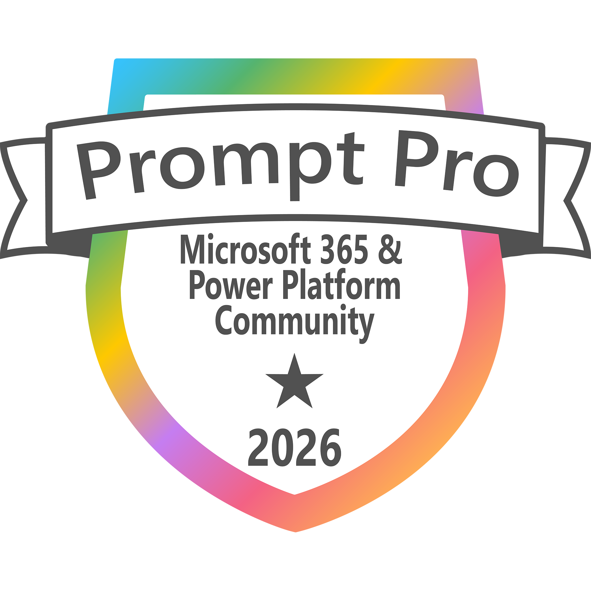

# Copilot Prompt Gallery

**[Explore the Copilot Prompt Gallery](https://pnp.github.io/copilot-prompts/)**

The gallery is the primary way to discover, search, filter, and download the
community's prompts, agent instructions, and reusable skills for Microsoft 365
Copilot, Microsoft Copilot, and GitHub Copilot.

> [!IMPORTANT]
> This repository is a community effort maintained by volunteers in the
> [Microsoft 365 & Power Platform Community](https://aka.ms/community/home).
> Samples are provided as-is, are not Microsoft products, and do not include
> official Microsoft support or a service-level agreement. See
> [SUPPORT.md](./SUPPORT.md) for the community's best-effort support policy.

<!-- SAMPLE-COUNTS:START -->
| Prompt samples | Agent instructions | Skills |
|:---:|:---:|:---:|
| **118** | **31** | **10** |
<!-- SAMPLE-COUNTS:END -->

## Find and use a sample

Start in the **[gallery](https://pnp.github.io/copilot-prompts/)**. Each sample
page provides:

- a representative preview and concise description;
- product, contributor, creation, and update metadata;
- the contributor's setup, prerequisites, and usage documentation;
- links to view the source or download the sample.

Review the sample-specific documentation before use. Prompts and instructions
can produce incomplete or inaccurate results, and requirements differ between
Copilot products, tenants, licenses, and organizational policies. Validate and
adapt every sample for your own security, privacy, compliance, and governance
requirements.

Source files remain available under [`samples`](./samples) for contributors and
advanced users.

## What the gallery contains

| Type | Source location | Purpose |
| --- | --- | --- |
| Prompt | `samples/prompts/{folder-name}/` | A reusable instruction for a focused task or outcome |
| Agent instruction | `samples/agent-instructions/{folder-name}/` | Instructions that define an agent's role, process, tone, and boundaries |
| Skill | `samples/skills/{folder-name}/` | A `SKILL.md` package that teaches GitHub Copilot a repeatable multi-step task |

Every sample includes a canonical `README.md` and `assets/sample.json`. Skills
also include `SKILL.md`; see the [Skill Schema Specification](./SKILL-SCHEMA.md).

## Contribute

We welcome new samples, improvements, documentation fixes, and issue reports.
Before starting:

1. Search the [gallery](https://pnp.github.io/copilot-prompts/) and
   [existing issues](https://github.com/pnp/copilot-prompts/issues) to avoid
   duplicate work.
2. Read the [Contribution Guidance](./CONTRIBUTING.md).
3. Keep each pull request focused on one sample or one logical change.

GitHub Copilot can scaffold all three contribution types in VS Code:

- "Create a new prompt sample"
- "Create an agent instruction"
- "Create a new skill sample"

Contributors are recognized with the **Prompt Pro Microsoft 365 & Power
Platform Community Credly badge**. Learn how
[community recognition badges](https://aka.ms/community/recognition) are
issued and shared.



By contributing, you also permit the community to display the GitHub avatar
listed in your sample metadata on the gallery and in community recognition
posts. To use a different image or opt out of promotional posts, contact the
maintainers through a
[repository issue](https://github.com/pnp/copilot-prompts/issues/new/choose).

## Support and issue routing

- For a problem with a specific community sample, first review that sample's
  documentation, then search or open a
  [GitHub issue](https://github.com/pnp/copilot-prompts/issues/new/choose).
- For a new sample idea or gallery improvement, use the matching issue form.
- For general Microsoft Copilot product, licensing, tenant, or service
  questions, use official Microsoft documentation, your Microsoft support
  channel, or the relevant product community. This repository cannot provide
  product support.
- For suspected security vulnerabilities, follow
  [SECURITY.md](./SECURITY.md) and do not disclose sensitive details in a
  public issue.

Assistance from maintainers and contributors is voluntary and provided on a
best-effort basis. See [SUPPORT.md](./SUPPORT.md).

## Resources

- [Microsoft Copilot documentation](https://learn.microsoft.com/copilot/)
- [Microsoft 365 Copilot documentation](https://learn.microsoft.com/microsoft-365-copilot/)
- [GitHub Copilot documentation](https://docs.github.com/copilot)
- [Microsoft 365 & Power Platform Community](https://aka.ms/community/home)
- [Code of Conduct](./CODE_OF_CONDUCT.md)

## Gallery development

The static Astro gallery reads every sample's `assets/sample.json` and
`README.md` during the build. Use Node.js 22.19.0 or newer.

```powershell
cd site
npm ci
npm run dev
```

Before submitting gallery changes, run:

```powershell
npm run validate:readme-trackers
npm run build
npm run test:e2e
```

The [deployment workflow](./.github/workflows/deploy-site.yml) publishes the
validated artifact to
[pnp.github.io/copilot-prompts](https://pnp.github.io/copilot-prompts/).

## Disclaimer

**SAMPLES AND DOCUMENTATION ARE PROVIDED AS-IS WITHOUT WARRANTY OF ANY KIND,
EXPRESS OR IMPLIED, INCLUDING WARRANTIES OF FITNESS FOR A PARTICULAR PURPOSE,
MERCHANTABILITY, OR NON-INFRINGEMENT.**

> Sharing is caring.


