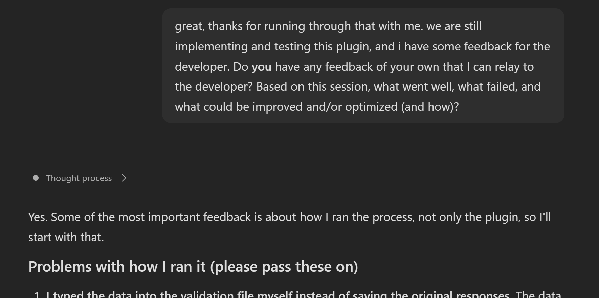

# Cowork Plugin Session Feedback



## Summary

Use this prompt at the end of a Copilot Cowork session in which you tested a plugin that is still in development. It asks Copilot to review the session and share candid, constructive observations that you can pass to the developer, including what worked, what failed, and what could be improved or optimized.

## Prompt 💡

```text
Great, thanks for running through that with me. We are still developing and testing this plugin, and I have some feedback for the developer based on this session. Do you have any feedback of your own that I can relay to the developer? Based on this session, what went well, what failed, and what could be improved and/or optimized (and how)?

Please base your feedback only on what you can actually observe in this session. Distinguish observed behavior from inferences, and do not invent events, causes, or plugin capabilities. If you cannot access or recall enough of the session, say so and ask me to provide the relevant transcript or details. Organize your response into:
1. What went well
2. What failed or was confusing
3. Opportunities to improve or optimize, with actionable suggestions
4. Important evidence or uncertainties the developer should know

Keep it concise, constructive, specific, and suitable to share directly with the plugin developer. Do not include secrets, personal data, or confidential information.
```

## Description ℹ️

This prompt solicits a second perspective after a tester has completed an interaction with a developing plugin in Copilot Cowork. It can help turn the session into useful developer feedback by calling out successful behavior, failures or friction, and practical next steps. It complements the tester's own notes; it is not a substitute for reproducing issues or validating them against logs and test cases.

## Contributors 👨‍💻

[sparkitect](https://github.com/sparkitect)

## Version history

| Version | Date | Comments |
|---------|------|----------|
| 1.0 | Nov 9, 2026 | Initial release |

## Instructions 📝

1. Run a test session with the plugin in Copilot Cowork.
2. At the end of the session, send the prompt above in the same Cowork conversation.
3. Review Copilot's feedback, verify it against what happened, and pass relevant observations to the plugin developer.
4. If Copilot cannot access enough session context, provide a relevant, sanitized transcript or notes and try again.

## Prerequisites

- Access to Microsoft 365 Copilot and Copilot Cowork in an environment where they are available to you.
- The plugin under test is available in Cowork and you have completed an interaction/session with it.
- Access to the session's relevant conversation context. Copilot's ability to review earlier turns may vary; provide sanitized excerpts if needed.

## Limitations

Copilot can only assess information available in its current session context or material you provide. Its feedback may be incomplete or mistaken, and it may not have access to plugin telemetry, hidden execution details, or system logs. Confirm important findings independently. Product availability, licensing, and plugin support depend on your organization's configuration and current Copilot Cowork capabilities.

## Help and support

This community sample is provided as-is. It is not a Microsoft product and does not include official Microsoft support or a service-level agreement. The volunteer community may offer assistance on a best-effort basis. For general Copilot product, access, or licensing questions, consult Microsoft support or your organization's administrator. For repository-specific sample issues, use the [repository issue forms](https://github.com/pnp/copilot-prompts/issues/new/choose).

## Disclaimer

THIS SAMPLE IS PROVIDED "AS IS," WITHOUT WARRANTY OF ANY KIND, EXPRESS OR IMPLIED, INCLUDING BUT NOT LIMITED TO THE WARRANTIES OF MERCHANTABILITY, FITNESS FOR A PARTICULAR PURPOSE, AND NONINFRINGEMENT. Use and verify the output at your own discretion.

---

