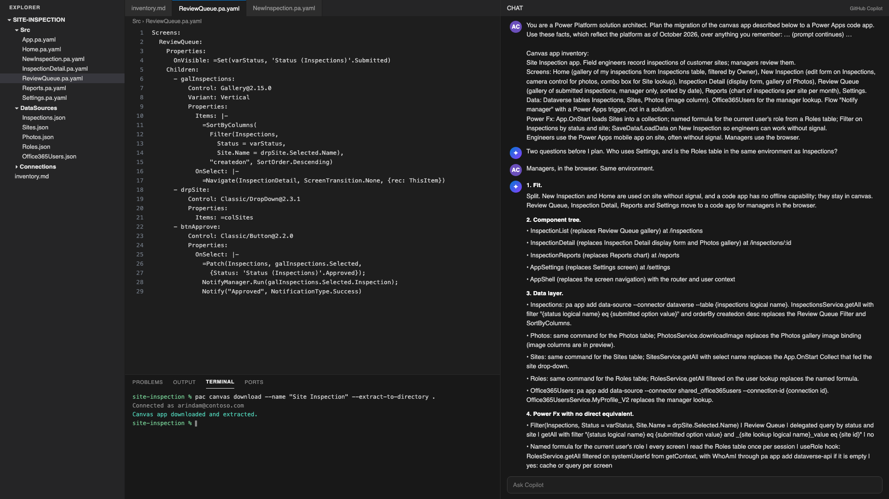

# Plan a canvas app to code app migration with GitHub Copilot



## Summary

Once a team has seen code apps, someone asks whether the canvas app can become one. The things that decide it are rarely written down anywhere, such as whether anyone uses it offline, how much of it is edit forms that got validation and required fields for free, and which Power Fx is doing real work. This prompt gives GitHub Copilot the inventory and the code app rules as they stand in October 2026, and asks for a plan an architect can take into an estimate.

## Prompt 💡

```text
You are a Power Platform solution architect. Plan the migration of the canvas app described below to a Power Apps code app. Use these facts, which reflect the platform as of October 2026, over anything you remember:

- A code app is a single-page app, React with TypeScript in Microsoft's templates, hosted by Power Apps, built with Vite and the @microsoft/power-apps client library, and deployed with the Power Apps CLI: pa app init, pa app add data-source, pa app add flow, pa app push --solution-id. The older pac code commands are marked for deprecation.
- Every user needs Power Apps Premium, pay-as-you-go, an app pass or auto-claim. An admin must enable code apps per environment. DLP applies at launch. Sharing limits and B2B guest access follow canvas apps; apps are shared with users or service principals, and security-group sharing is not documented for code apps. There is no anonymous access.
- Learn lists as unsupported: Power Apps for Windows, Power Platform Git integration, Secure Implicit Connections, Power BI data integration, SharePoint forms integration, and the SAS IP Binding and Firewall environment setting, so IP restriction needs Conditional Access by location. The Power Apps mobile app came off that list in May 2026, so treat it as available and test on the target devices. Teams hosting is not documented for code apps; treat it as a blocker until verified. Canvas runtime features with no code app equivalent: offline, canvas components, component libraries, PCF controls, SaveData and LoadData. The default content security policy blocks direct calls to external APIs unless an admin allow-lists the host, so plan external data through connectors.
- Data: native Dataverse tables give typed get, getAll, create, update and delete with OData filter, select, orderBy, top and paging, plus getMetadata, file and image columns (preview) and Dataverse actions and functions through pa app add dataverse-api. Learn lists polymorphic lookups, FetchXML, alternate keys and schema definition changes as unsupported. getAll has no expand or aggregate option, so related rows take a second call and lookups are set with @odata.bind. Every other connector except Excel Online is supported, as a tabular or an action source. Views, client-side business rules, form validation and choice option lists must be rebuilt in code; required-field rules can be read from getMetadata; server-side rules, formula columns and security roles still apply.
- Flows: only solution-aware instant flows with the Power Apps trigger, added with pa app add flow by someone who has access to the flow and its connections. Users need a Dataverse security role such as App Opener to run them.
- Routing, forms, validation, responsive layout, theming, device access through browser APIs, localization and error display are all the developer's code.

Canvas app inventory:
{paste here: the app name and purpose; each screen with its controls and what they bind to; data sources and tables; components and PCF controls; App.OnStart, named formulas and any Power Fx that matters; flows the app runs; device features; whether it is used offline, in Teams or in the Power Apps mobile app}

Before planning, ask me up to three questions if the inventory leaves a fit decision open. Then write the plan with exactly these sections:

1. Fit. Rebuild as a code app, keep canvas, or split. If a hard blocker applies (offline use, Teams hosting until verified, component or PCF dependencies, anonymous users) say so, say what stays in canvas, and plan only the part that moves.
2. Component tree. One line per React component: name, the canvas screen or control it replaces, and its route.
3. Data layer. One entry per data source: the pa command that adds it, the generated service, the calls that replace each Collect, Patch, Filter, LookUp and Remove, the OData filter for each query, and what the canvas forms gave for free that must be rebuilt.
4. Power Fx with no direct equivalent. A table with columns: formula, where used, what it did, code app approach, design decision needed (yes or no).
5. Lost or changed. What goes away or needs admin action: licensing per user, environment enablement, DLP, content security policy allow-list, sharing, flows that must move into a solution and the security role users need to run them.
6. Effort. Small, medium or large for each screen and each data source with one reason each, the three riskiest items, and the questions the business owner must answer.
7. Recommendation. Three sentences: rebuild, keep or split, and why.

Rules: never invent table names, IDs, connection IDs or environment details, write {placeholder} instead; map every item in the inventory and list anything you could not place; write no code blocks beyond one example service call, though service methods and OData filters named inline are fine; name the canvas feature being replaced on every line.
```

## Description ℹ️

GitHub Copilot's own knowledge of code apps is thin and partly out of date, so the prompt carries the facts that decide a migration. With those in front of it, Copilot has less to fill in from memory. One caution. Learn's limitations list is short and it changes. The Power Apps mobile app came off it in May 2026. Offline, Teams, PCF and components have never been on it. They are canvas runtime features that a code app has no equivalent for, not documented limitations. Re-check the third bullet of the prompt before you reuse it.

Fit comes first. If the app is used offline or depends on a component library, the plan says so and plans only the screens that can move, usually the back-office ones. Most of the effort turns up in the Power Fx table. A `Filter` that relies on delegation or a `Patch` to a polymorphic lookup looks like one line in canvas and is a design decision in code.

The inventory does not have to be complete. Paste what you have and answer whatever Copilot asks. Anything it reports as unplaced is the first thing to check in the maker portal.

### Example

Inventory pasted after the prompt:

> Site Inspection app. Field engineers record inspections of customer sites; managers review them.
> Screens: Home (gallery of my inspections from Inspections table, filtered by Owner), New Inspection (edit form on Inspections, camera control for photos, combo box for Site lookup), Inspection Detail (display form, gallery of Photos), Review Queue (gallery of submitted inspections, manager only, sorted by date), Reports (chart of inspections per site per month), Settings.
> Data: Dataverse tables Inspections, Sites, Photos (image column). Office365Users for the manager lookup. Flow "Notify manager" with a Power Apps trigger, not in a solution.
> Power Fx: App.OnStart loads Sites into a collection; named formula for the current user's role from a Roles table; Filter on Inspections by status and site; SaveData/LoadData on New Inspection so engineers can work without signal.
> Engineers use the Power Apps mobile app on site, often without signal. Managers use the browser.

Copilot asked first: "Two questions before I plan. Who uses Settings, and is the Roles table in the same environment as Inspections?" I answered "Managers, in the browser. Same environment." The plan opened with the fit decision and covered only the manager screens:

> 1\. Fit. Split. New Inspection and Home are used on site without signal, and a code app has no offline capability; they stay in canvas. Review Queue, Inspection Detail, Reports and Settings move to a code app for managers in the browser.
>
> 2\. Component tree.
> - InspectionList (replaces Review Queue gallery) at /inspections
> - InspectionDetail (replaces Inspection Detail display form and Photos gallery) at /inspections/:id
> - InspectionReports (replaces Reports chart) at /reports
> - AppSettings (replaces Settings screen) at /settings
> - AppShell (replaces the screen navigation) with the router and user context
>
> 3\. Data layer.
> - Inspections: pa app add data-source --connector dataverse --table {inspections logical name}. InspectionsService.getAll with filter "{status logical name} eq {submitted option value}" and orderBy createdon desc replaces the Review Queue Filter and SortByColumns.
> - Photos: same command for the Photos table; PhotosService.downloadImage replaces the Photos gallery image binding (image columns are in preview).
> - Sites: same command for the Sites table; SitesService.getAll with select name replaces the App.OnStart Collect that fed the site drop-down.
> - Roles: same command for the Roles table; RolesService.getAll filtered on the user lookup replaces the named formula.
> - Office365Users: pa app add data-source --connector shared_office365users --connection-id {connection id}. Office365UsersService.MyProfile_V2 replaces the manager lookup.
>
> 4\. Power Fx with no direct equivalent.
> - Filter(Inspections, Status = varStatus, Site.Name = drpSite.Selected.Name) | Review Queue | delegated query by status and site | getAll with filter "{status logical name} eq {submitted option value} and _{site lookup logical name}_value eq {site id}" | no
> - Named formula for the current user's role | every screen | read the Roles table once per session | useRole hook: RolesService.getAll filtered on systemUserId from getContext, with WhoAmI through pa app add dataverse-api if it is empty | yes: cache or query per screen
> - NotifyManager.Run(ThisItem.Inspection) | Review Queue approve | started the notification flow | move the flow into a solution, then pa app add flow and NotifyManagerService.Run | yes: who owns the solution
> - Chart of inspections per site per month | Reports | grouped counts over Inspections | native Dataverse has no aggregation; fetch with select and group in code, or a Dataverse function added with pa app add dataverse-api | yes: record volume
> - SaveData / LoadData | New Inspection | offline cache for engineers | none; the screen stays in canvas | not applicable

The rest of the plan sized the four moving screens as one medium and three small, and named moving the flow into a solution, plus the security role to run it, as the admin work beyond licensing and environment enablement. It recommended the split. The one question it left for the business owner was whether engineers will ever have reliable signal on site, because that would let the whole app move.

## Contributors 👨‍💻

[Arindam Choudhury](https://github.com/ari20089)

## Version history

Version|Date|Comments
-------|----|--------
1.0|October 24, 2026|Initial release

## Instructions 📝

1. Install the GitHub Copilot extension in Visual Studio Code and sign in.
2. Open GitHub Copilot Chat. Agent or Ask mode both work; the prompt needs no files from the workspace.
3. Gather the canvas app inventory. The quickest source is the app's `.pa.yaml` files. Save the `.msapp` from Power Apps Studio (File, Save as, This computer), rename it to `.zip` and extract it, or fetch it already extracted with `pac canvas download --name {app} --extract-to-directory {folder}`, then read the files under `Src`. If the app is in a solution with Git integration you already have the YAML files. Studio's right-click View code shows the YAML for a control and its children but not the App object, so App.OnStart and named formulas need one of the other routes. A screen-by-screen list written by hand works too.
4. Paste the prompt, replace the placeholder block with your inventory, and send it.
5. Answer Copilot's questions, if it has any, then read the fit section before anything else.
6. Take the Power Fx table and the effort section into the estimate, and send the lost-or-changed section to the Power Platform admin.

### Improvise Usage 🚀

- Run it against an extracted `.msapp` in the workspace and ask Copilot to build the inventory from the YAML first, then plan.
- Add your firm's React component library or design system name and ask for the component tree to use it.
- Ask for section 6 only, to re-estimate after a scope change.
- Change the target from React to Vue if your team builds in Vue; the platform facts do not change.
- For a portfolio review, run it once per app and ask for a one-line verdict each, then compare.

## Prerequisites

* [GitHub Copilot](https://copilot.github.com/)

## Help

We do not support samples, but this community is always willing to help, and we want to improve these samples. We use GitHub to track issues, which makes it easy for community members to volunteer their time and help resolve issues.

You can try looking at [issues related to this sample](https://github.com/pnp/copilot-prompts/issues?q=label%3A%22sample%3A%20github-canvas-to-code-app-plan-prompt%22) to see if anybody else is having the same issues.

If you encounter any issues using this sample, [create a new issue](https://github.com/pnp/copilot-prompts/issues/new).

Finally, if you have an idea for improvement, [make a suggestion](https://github.com/pnp/copilot-prompts/issues/new).

## Disclaimer

**THIS CODE IS PROVIDED *AS IS* WITHOUT WARRANTY OF ANY KIND, EITHER EXPRESS OR IMPLIED, INCLUDING ANY IMPLIED WARRANTIES OF FITNESS FOR A PARTICULAR PURPOSE, MERCHANTABILITY, OR NON-INFRINGEMENT.**


