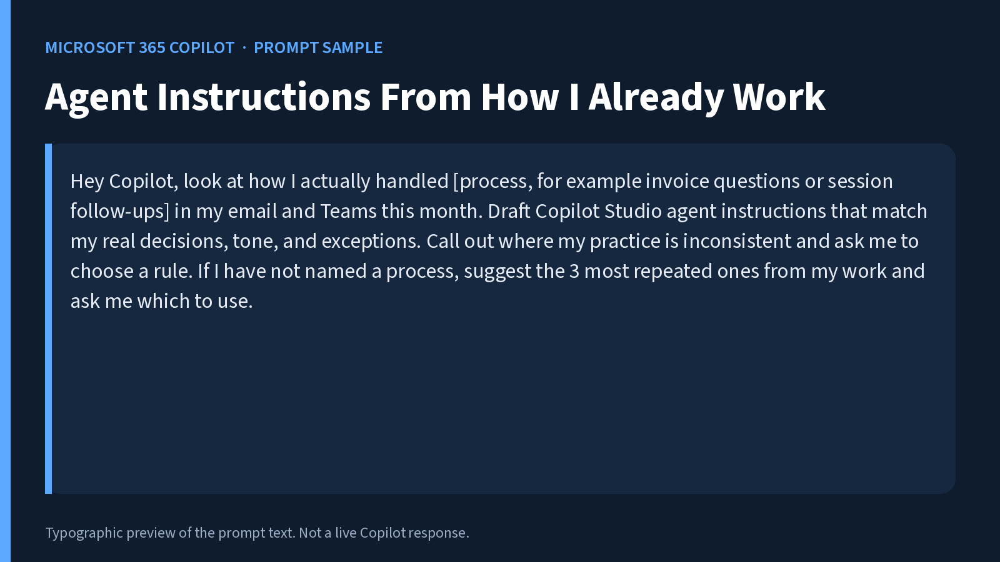

# Agent Instructions From How I Already Work

## Summary

Ask Microsoft 365 Copilot to draft Copilot Studio agent instructions from how you already handle a process in email and Teams.

## Prompt 💡

Hey Copilot, look at how I actually handled [process, for example invoice questions or session follow-ups] in my email and Teams this month. Draft Copilot Studio agent instructions that match my real decisions, tone, and exceptions. Call out where my practice is inconsistent and ask me to choose a rule. If I have not named a process, suggest the 3 most repeated ones from my work and ask me which to use.

## Description ℹ️

The most useful agent instructions often come from the way you already work, not from a blank template. This prompt asks Microsoft 365 Copilot to study a process you already handle in email and Teams, then draft Copilot Studio agent instructions that reflect your real decisions, tone, and exceptions. If you have not named a process, it can suggest the most repeated ones and ask which to use. When your practice is inconsistent, it should call that out and ask you to choose a rule instead of guessing.

In Microsoft 365 Copilot with work grounding, [Work IQ](https://learn.microsoft.com/microsoft-365/copilot/extensibility/work-iq/) provides work context from sources such as emails, meetings, chats, and files. The response depends on the context available to Copilot and your access permissions; this sample does not require a separate Work IQ integration.

Copilot may miss exceptions that are not written down, or turn a one-off judgment into a hard rule. Read the draft carefully, resolve any inconsistent rules yourself, and remove confidential details before you paste the instructions into Copilot Studio. This prompt drafts instructions; it does not create the agent for you.

### Responsible use and sharing

Use this prompt on work you are allowed to review. Do not use it to capture another person's private conversations or to encode confidential customer handling into a shareable agent. Review and redact every response and screenshot before sharing so no personal information, client or project details, or other confidential information is revealed. Follow your organization's privacy, security, and AI-governance policies.

## Contributors 👨‍💻

[Renato Romão](https://github.com/renatoromao), Microsoft MVP

## Version history

Version|Date|Comments
-------|----|--------
1.0|November 25, 2026|Initial release

## Instructions 📝

1. Sign in with your work account and ensure you have access to Microsoft 365 Copilot with work grounding.
2. Open Microsoft 365 Copilot Chat in Teams or the Microsoft 365 Copilot app, using work mode where available.
3. Copy the prompt above, replace the placeholder with the process you want to capture, then send it. If you are unsure which process to use, send the prompt as written and let Copilot suggest options.
4. Review the drafted instructions, choose any missing rules, and only then paste them into a Copilot Studio agent.

### Improvise Usage 🚀

As a follow-up, ask Copilot to add example user prompts, a short test set, or a stricter exclusion list. You can also narrow the source to email only or Teams only, or ask for a side-by-side comparison of two ways you currently handle the same request. Avoid including secrets, account numbers, or customer identifiers in the draft.

## Prerequisites

* [Copilot for Microsoft 365](https://developer.microsoft.com/microsoft-365/dev-program)
* Access to Microsoft 365 Copilot with work grounding, subject to your organization's licensing and configuration.
* A Copilot Studio license is only required if you decide to create the agent from the drafted instructions.

## Help

We do not support samples, but this community is always willing to help, and we want to improve these samples. We use GitHub to track issues, which makes it easy for community members to volunteer their time and help resolve issues.

You can try looking at [issues related to this sample](https://github.com/pnp/copilot-prompts/issues?q=label%3A%22sample%3A%20m365-agent-instructions-from-how-i-already-work-prompt%22) to see if anybody else is having the same issues.

If you encounter any issues using this sample, [create a new issue](https://github.com/pnp/copilot-prompts/issues/new).

Finally, if you have an idea for improvement, [make a suggestion](https://github.com/pnp/copilot-prompts/issues/new).

## Disclaimer

**THIS CODE IS PROVIDED *AS IS* WITHOUT WARRANTY OF ANY KIND, EITHER EXPRESS OR IMPLIED, INCLUDING ANY IMPLIED WARRANTIES OF FITNESS FOR A PARTICULAR PURPOSE, MERCHANTABILITY, OR NON-INFRINGEMENT.**

