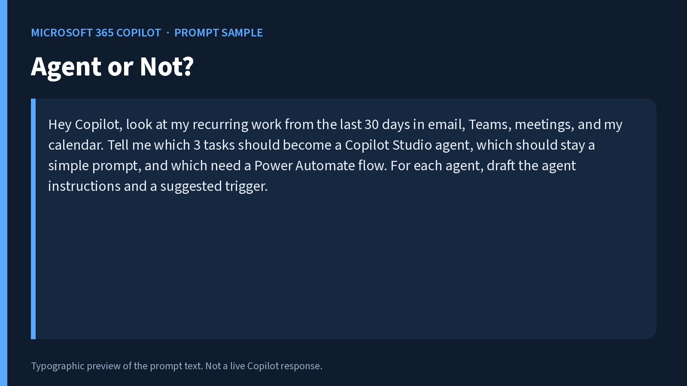

# Agent or Not?

## Summary

Use Microsoft 365 Copilot and available Work IQ context to decide which recurring tasks should become a Copilot Studio agent, stay a simple prompt, or become a Power Automate flow.

## Prompt 💡

Hey Copilot, look at my recurring work from the last 30 days in email, Teams, meetings, and my calendar. Tell me which 3 tasks should become a Copilot Studio agent, which should stay a simple prompt, and which need a Power Automate flow. For each agent, draft the agent instructions and a suggested trigger.

## Description ℹ️

Not every repeated task should become an agent. This prompt asks Microsoft 365 Copilot to look at your recent work and sort recurring tasks into three buckets: a Copilot Studio agent, a reusable prompt, or a Power Automate flow. For each agent recommendation, it drafts the agent instructions and a suggested trigger so you can review them before building anything.

In Microsoft 365 Copilot with work grounding, [Work IQ](https://learn.microsoft.com/microsoft-365/copilot/extensibility/work-iq/) provides work context from sources such as emails, meetings, chats, and files. The response depends on the context available to Copilot and your access permissions; this sample does not require a separate Work IQ integration.

Copilot may over-recommend agents when context is thin, or miss work that happens outside Microsoft 365. Treat the output as a starting point, not a build plan. Review every recommendation for accuracy, confidentiality, and whether the task really needs an agent before you create one in Copilot Studio or Power Automate.

### Responsible use and sharing

Use this prompt to plan your own automation, not to inspect a colleague's work without a clear business reason. Review and redact every response and screenshot before sharing so no personal information, client or project details, or other confidential information is revealed. Follow your organization's privacy, security, and AI-governance policies. Do not paste secrets, customer data, or tenant identifiers into a public sample or screenshot.

## Contributors 👨‍💻

[Renato Romão](https://github.com/renatoromao), Microsoft MVP

## Version history

Version|Date|Comments
-------|----|--------
1.0|November 25, 2026|Initial release

## Instructions 📝

1. Sign in with your work account and ensure you have access to Microsoft 365 Copilot with work grounding.
2. Open Microsoft 365 Copilot Chat in Teams or the Microsoft 365 Copilot app, using work mode where available.
3. Copy and paste the prompt above, then send it.
4. Review the recommendations. If you decide to build an agent or a flow, paste the drafted instructions into Copilot Studio or Power Automate and adapt them to your environment.

### Improvise Usage 🚀

As a follow-up, ask Copilot to focus on one workload, a specific team, or a shorter time window. You can also ask it to rank the agent ideas by effort versus impact, or to rewrite one set of agent instructions in your voice. Avoid asking it to automate someone else's work or to include confidential customer details in the draft instructions.

## Prerequisites

* [Copilot for Microsoft 365](https://developer.microsoft.com/microsoft-365/dev-program)
* Access to Microsoft 365 Copilot with work grounding, subject to your organization's licensing and configuration.
* A Copilot Studio or Power Automate license is only required if you decide to build the recommended agent or flow.

## Help

We do not support samples, but this community is always willing to help, and we want to improve these samples. We use GitHub to track issues, which makes it easy for community members to volunteer their time and help resolve issues.

You can try looking at [issues related to this sample](https://github.com/pnp/copilot-prompts/issues?q=label%3A%22sample%3A%20m365-agent-or-not-prompt%22) to see if anybody else is having the same issues.

If you encounter any issues using this sample, [create a new issue](https://github.com/pnp/copilot-prompts/issues/new).

Finally, if you have an idea for improvement, [make a suggestion](https://github.com/pnp/copilot-prompts/issues/new).

## Disclaimer

**THIS CODE IS PROVIDED *AS IS* WITHOUT WARRANTY OF ANY KIND, EITHER EXPRESS OR IMPLIED, INCLUDING ANY IMPLIED WARRANTIES OF FITNESS FOR A PARTICULAR PURPOSE, MERCHANTABILITY, OR NON-INFRINGEMENT.**

