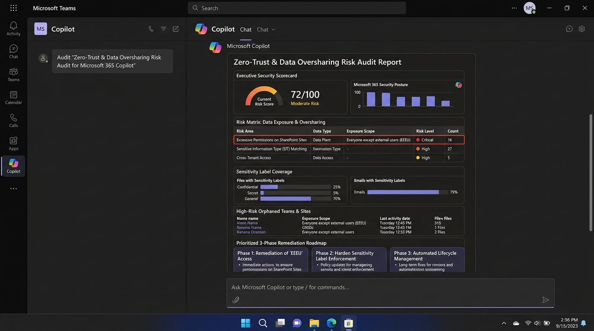

# 🛡️ Microsoft 365 Copilot Zero-Trust & Oversharing Risk Audit 🔍



## Summary

When rolling out Microsoft 365 Copilot, the single greatest operational and security concern is **oversharing**. Copilot strictly honors existing user permissions—meaning if confidential salary files, executive merger discussions, or customer PII are accessible to broad groups like **"Everyone except external users" (EEEU)** or broad company-wide Team sites, Copilot will surface that data in search and chat answers to non-privileged users.

This prompt acts as a **Microsoft 365 Zero-Trust Architect and Data Security Lead**. It accepts governance reports, site lists, audit logs, or environment summaries and produces an executive-ready Zero-Trust Audit Report featuring an **Executive Security Scorecard**, a **Data Exposure Risk Matrix**, sensitivity label gap analysis, and a prioritized **3-phase remediation plan** with actionable PowerShell commands.

## Prompt 💡

```text
You are a Principal Microsoft 365 Zero-Trust Architect and Cloud Security Specialist.
Perform a comprehensive Zero-Trust Data Exposure & Oversharing Risk Audit for our Microsoft 365 tenant to ensure secure, compliant rollout and operation of Microsoft 365 Copilot.

Context and Governance Information:
{PASTE_YOUR_M365_TENANT_DATA_OR_SHAREPOINT_INVENTORY_OR_PURVIEW_REPORT_HERE}
(If no live tenant data is provided, generate a representative benchmark audit using industry standard baselines for an enterprise with 2,500 users).

Please conduct the audit across the following key security pillars:

1. Executive Security Scorecard:
   - Overall Tenant Copilot Security Readiness Score (0–100)
   - Risk classification (Low / Moderate / High / Critical)
   - Primary data leakage threat vectors identified
   - High-level executive summary suitable for CISO and IT Steering Committee

2. Data Exposure & Oversharing Risk Matrix:
   - Identify sites, libraries, and OneDrive accounts with excessive permissions:
     * Exposure Scope: "Everyone except external users" (EEEU), public "Anyone" links, or wide domain-wide sharing
     * Risk rating per container (Critical / High / Medium / Low)
     * Sensitive Information Types (SIT) detected (Financial records, HR/Comp, PII, Source Code, Credentials)
     * Total estimated impacted files and users

3. Information Protection & Classification Gap Analysis:
   - Sensitivity Label coverage (% labeled vs. unlabeled documents in high-business-impact repositories)
   - Misaligned permissions (e.g., Highly Confidential labels stored in publicly accessible or EEEU-granted sites)
   - Data Loss Prevention (DLP) policy gaps for Copilot chat grounding and OneDrive synchronization

4. High-Risk Workspace Identification:
   - Orphaned Teams / SharePoint sites (no active owner or last activity > 180 days) containing business-critical files
   - Cross-tenant external guest access risks
   - Shared Channels with external collaboration

5. Prioritized 3-Phase Remediation Roadmap:
   - Phase 1 (Immediate - 0 to 14 days): Critical containment of EEEU access on sensitive repositories, disabling legacy sharing links, and isolating high-risk sites with Restricted SharePoint Search (RSS).
   - Phase 2 (Hardening - 15 to 45 days): Default sensitivity labeling rollout, auto-labeling policies, and Purview Data Security Posture Management (DSPM) for AI.
   - Phase 3 (Continuous Governance - 46 to 90 days): Automated access reviews, lifecycle management for orphaned teams, and Entra ID Privileged Identity Management (PIM).

6. PowerShell Remediation Playbook:
   - Provide concrete, copy-pasteable PowerShell cmdlets (using PnP PowerShell / Microsoft Graph PowerShell) to:
     * Find and report all SharePoint sites with "Everyone except external users" granted permissions.
     * Enable Restricted SharePoint Search to limit Copilot indexing scope until remediation is complete.
     * Enforce sensitivity label inheritance.

Output the entire analysis with clean Markdown formatting, using structured tables for the matrices, clear severity callouts, and bullet points for all operational recommendations.
```

## Description ℹ️

Microsoft 365 Copilot utilizes the Semantic Index and Microsoft Graph to ground prompts against content a user has permission to view. When organizational permissions are too loose (a common legacy pattern in SharePoint and Teams), users inadvertently discover confidential data through Copilot queries.

This prompt provides IT administrators, security engineers, and compliance officers with:
- A standardized risk evaluation framework aligned with Microsoft's Zero-Trust architecture.
- Clear distinction between systemic permission overexposure vs. missing label hygiene.
- Actionable containment mechanisms (including `Set-SPOTenant -RestrictedSearchMode Enabled`).
- Audit-ready deliverables that bridge the gap between technical IT administration and executive leadership.

## Contributors 👨‍💻

[Sapan Patel](https://github.com/sapanpatel1230)

## Version history

Version|Date|Comments
-------|----|--------
1.0|Oct 23, 2026|Initial release

## Instructions 📝

1. Verify you have access to **Copilot for Microsoft 365** (via Microsoft Teams, Bing/Copilot Chat in Edge, or [copilot.microsoft.com](https://copilot.microsoft.com)).
2. Open the **Copilot** app in Microsoft Teams or navigate to Microsoft 365 Copilot Chat in your browser.
3. Switch to **Work** mode (ensuring responses are grounded in tenant organizational data).
4. Paste the prompt text from the [Prompt](#prompt-) section above into the input area.
5. In the `{PASTE_YOUR_M365_TENANT_DATA_...}` section:
   - Option A: Paste an export of your SharePoint Administrator Site Inventory CSV or Microsoft Purview Information Protection summary report.
   - Option B: Type a short summary of your current environment (e.g., *"We have 180 SharePoint sites, 45 Teams, and recently noticed financial spreadsheets are open to all employees"*).
   - Option C: Leave blank to generate an authoritative enterprise benchmark and remediation blueprint.
6. Press **Send** and review the generated audit report.

### Improvise Usage 🚀

1. **Departmental Deep-Dive**: Ask Copilot: *"Focus specifically on our Finance and Human Resources SharePoint sites, identifying which specific salary or payroll folders are at risk of being surfaced by Copilot."*
2. **Restricted SharePoint Search Scoping**: Prompt Copilot: *"Draft the exact business justification and list of up to 100 enterprise-approved sites to include in our initial Restricted SharePoint Search (RSS) list while we remediate wider permissions."*
3. **CISO Presentation Slide Generator**: Prompt Copilot: *"Convert Section 1 and Section 5 of this audit into a 4-slide executive presentation outline suitable for our Chief Information Security Officer."*
4. **Purview Policy Generator**: Ask Copilot: *"Generate the exact Microsoft Purview Data Loss Prevention (DLP) rule definitions needed to prevent credit card numbers and employee SSNs from being summarized in Copilot chat."*

## Prerequisites

* [Copilot for Microsoft 365 license](https://developer.microsoft.com/microsoft-365/dev-program)
* Basic familiarity with Microsoft 365 Admin Center, SharePoint Admin Center, or Microsoft Purview Compliance Portal

## Remediation Automation Scripts 🛠️

To rapidly support the audit findings produced by Copilot, administrators can execute these standard PnP PowerShell and SharePoint Online cmdlets:

### 1. Identify "Everyone Except External Users" (EEEU) across sites
```powershell
# Connect to SharePoint Online Admin Center
Connect-SPOService -Url "https://<your-tenant>-admin.sharepoint.com"

# Query sites with broad organizational sharing enabled
Get-SPOSite -Limit All | Select-Object Url, Title, SharingCapability, Status | Where-Object { $_.SharingCapability -ne "Disabled" }
```

### 2. Enable Restricted SharePoint Search (RSS) as a temporary safety guardrail
```powershell
# Limit Copilot grounding to a curated list of up to 100 sites while permissions are audited
Set-SPOTenant -RestrictedSearchMode $true
```

## Help

We do not support samples, but this community is always willing to help, and we want to improve these samples. We use GitHub to track issues, which makes it easy for community members to volunteer their time and help resolve issues.

You can try looking at [issues related to this sample](https://github.com/pnp/copilot-prompts/issues?q=label%3A%22sample%3A%20m365-copilot-zero-trust-oversharing-audit%22) to see if anybody else is having the same issues.

If you encounter any issues using this sample, [create a new issue](https://github.com/pnp/copilot-prompts/issues/new).

Finally, if you have an idea for improvement, [make a suggestion](https://github.com/pnp/copilot-prompts/issues/new).

## Disclaimer

**THIS CODE IS PROVIDED *AS IS* WITHOUT WARRANTY OF ANY KIND, EITHER EXPRESS OR IMPLIED, INCLUDING ANY IMPLIED WARRANTIES OF FITNESS FOR A PARTICULAR PURPOSE, MERCHANTABILITY, OR NON-INFRINGEMENT.**

---

