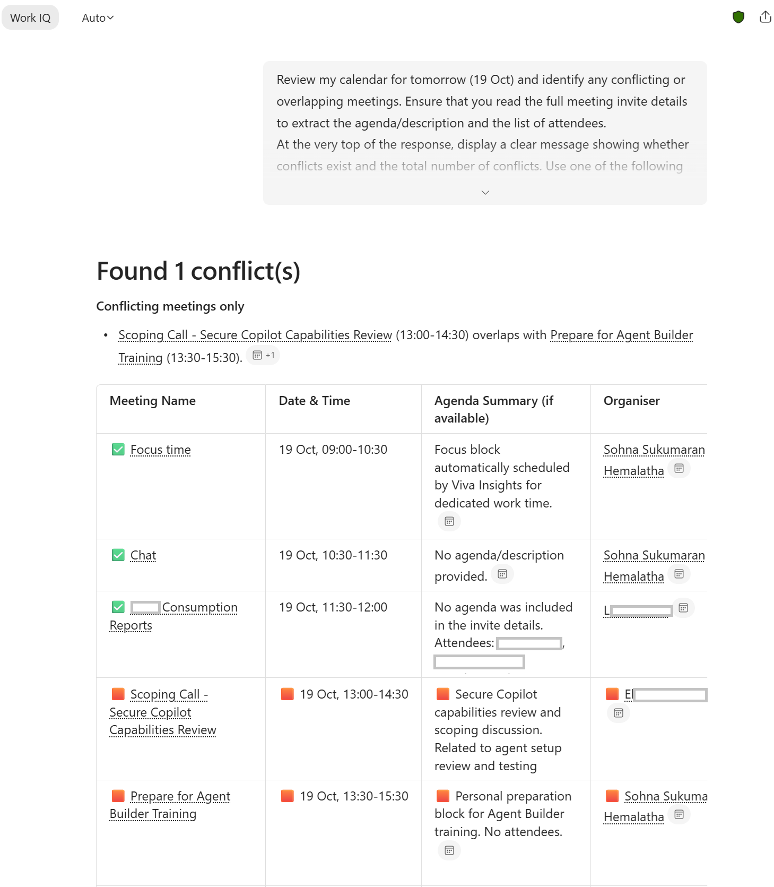

# 🔍📅Meeting conflict analysis of your calendar

## Summary

This prompt reviews your calendar and analyzes meetings for a specified date, identifies any overlapping or conflicting meetings and presents a clear conflict summary highlighting impacted meetings for quick review.

## Prompt 💡

Review my calendar for [today] and identify any conflicting or overlapping meetings. Ensure that you read the full meeting invite details to extract the agenda/description and the list of attendees.

At the very top of the response, display a clear message showing whether conflicts exist and the total number of conflicts. Use one of the following formats depending on the result:
- “Found X conflict(s)”
- “✅ You are all good – No meeting conflicts found”

Create a table with the following columns: 

Meeting Name | Date & Time | Agenda Summary (if available) | Organiser | Conflict Status

For any meeting that has a conflict, add 🟧 at the beginning of every cell in that row for easy visibility. If there are no conflicts, indicate ✅ at the beginning of the first cell of "Meeting Name" only.

On top of the table, provide a short summary listing only the conflicting meetings (no recommendations). If there are no conflicts, don't include this information.​‌

## Description ℹ️

Quickly identify overlapping or conflicting meetings in your calendar, complete with meeting context, organizers and attendees. Ideal for daily or weekly planning to avoid double-bookings, prioritise commitments and proactively resolve scheduling clashes.

The output report presents conflicts with a summary and clear visual indicators, making it easy to review and take action before meetings are missed or schedules become overloaded.

## Contributors 👨‍💻

[Sohna Sukumaran Hemalatha](https://github.com/sohna-sh)

LinkedIn - [Sohna Sukumaran Hemalatha](https://www.linkedin.com/in/sohna-s-h/)

## Version history

Version|Date|Comments
-------|----|--------
1.0|October 18, 2026|Initial release

## Instructions 📝

1. Ensure you have a Microsoft 365 Copilot license.
2. Open Copilot Chat (using Copilot app / Copilot on the browser / Copilot on Teams).
3. Ensure that "Work IQ" is turned on.
3. Copy and paste the above prompt.
4. (Optional) Schedule the prompt to run daily or weekly or on specific days.

### Improvise Usage 🚀

You can customize this prompt and replace [today] with a specific date, tomorrow, this week, next week or any custom date range.

## Prerequisites

* [Copilot or Microsoft 365 Copilot](https://copilot.microsoft.com/)

## Help

We do not support samples, but this community is always willing to help, and we want to improve these samples. We use GitHub to track issues, which makes it easy for community members to volunteer their time and help resolve issues.

You can try looking at [issues related to this sample](https://github.com/pnp/copilot-prompts/issues?q=label%3A%22sample%3A%20m365-meeting-conflict-analysis) to see if anybody else is having the same issues.

If you encounter any issues using this sample, [create a new issue](https://github.com/pnp/copilot-prompts/issues/new).

Finally, if you have an idea for improvement, [make a suggestion](https://github.com/pnp/copilot-prompts/issues/new).

## Disclaimer

**THIS CODE IS PROVIDED *AS IS* WITHOUT WARRANTY OF ANY KIND, EITHER EXPRESS OR IMPLIED, INCLUDING ANY IMPLIED WARRANTIES OF FITNESS FOR A PARTICULAR PURPOSE, MERCHANTABILITY, OR NON-INFRINGEMENT.**

---
