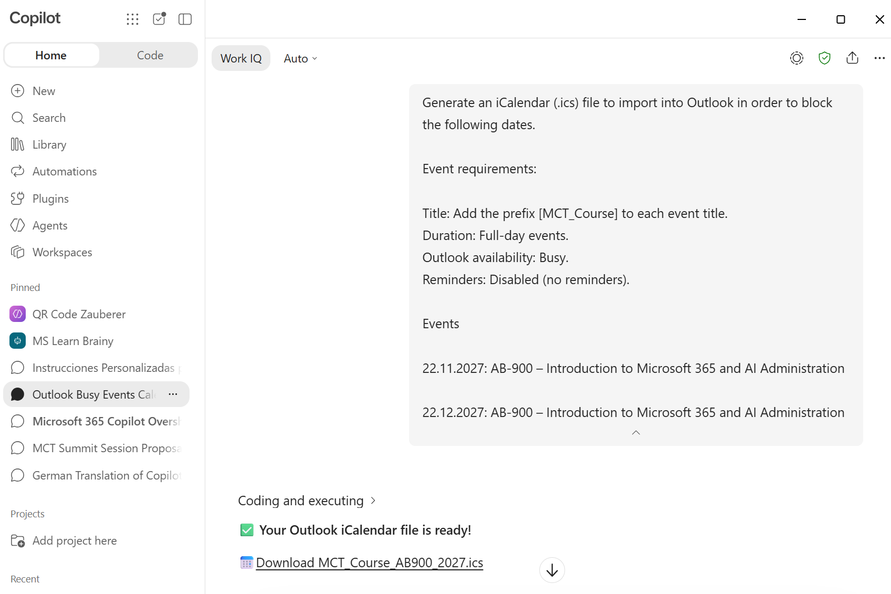
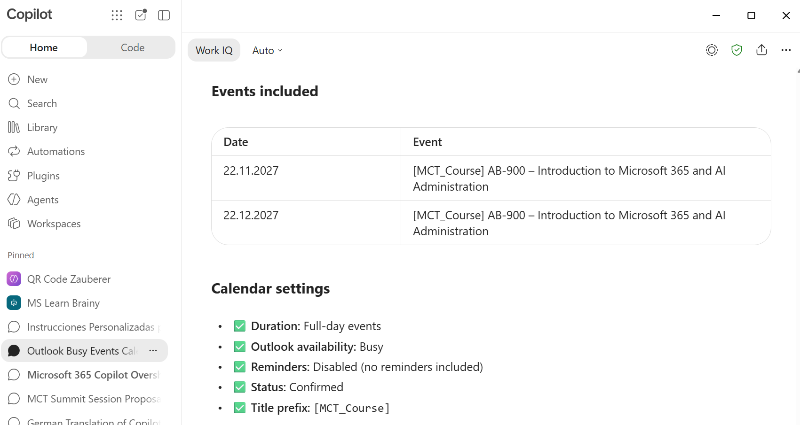
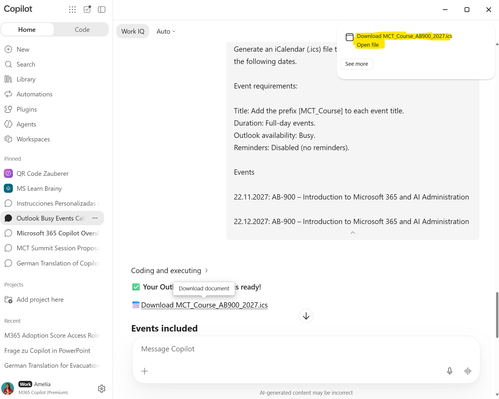

# 📅Outlook iCal File Generator
 

 
## Summary
 
This prompt generates an Outlook-compatible iCalendar (.ics) file from a list of events and dates using Copilot.
 
## Prompt 💡
 
Generate an iCalendar (.ics) file to import into Outlook
in order to block the following dates.

Event requirements:

- Title: Add the prefix [prefix] to each event title.
- Duration: [duration]
- Outlook availability: [availability].
- Reminders: [reminder].

Events:

[event date]: [event title]

Generate a downloadable .ics file containing all listed events. 
 
## Description ℹ️
 
Quickly block multiple dates in your Outlook calendar without creating each event manually.

The Outlook iCal File Generator helps you turn a simple list of dates and event names into a ready-to-import calendar file.

Example use cases:

Blocking dates for upcoming training courses.
Reserving days for conferences or workshops.
Planning recurring professional commitments on specific dates.
Creating calendar blocks for project activities.

## Contributors 👨‍💻
 
[Amelia Hernández Osorio](https://github.com/ameliahernandez)
 
LinkedIn - [Amelia Hernández Osorio](https://www.linkedin.com/in/ameliahernandezo/)
 
## Version history
 
Version|Date|Comments
-------|----|--------
1.0|November 28, 2026|Initial release
 
## Instructions 📝
 
1. Use this prompt with both Copilot Basic and Copilot Premium.
2. Open Copilot Chat (using Copilot app / Copilot on the browser / Copilot on Outlook).
3. Copy and paste the above prompt.
4. Replace the example events with your own dates and event titles.
5. Adjust the event requirements if needed.
6. Run the prompt to generate the iCalendar (.ics) file.
7. Download the generated file.
8. Import the file into your Outlook calendar.
9. Verify that the events have the correct dates, availability settings, and reminders.
 
### Improvise Usage 🚀
 
You can customize this prompt and replace [event date] and [event title] with your event dates and titles. Adjust the event requirements by replacing [prefix], [duration], [availability] and [reminder] with your own requirements, for example: 

- Title: Add the prefix [mct-course] to each event title.
- Duration: full day.
- Outlook availability: busy.
- Reminders: enabled.
 
## Prerequisites
 
* [Copilot Basic or Microsoft 365 Copilot](https://copilot.microsoft.com/)
* Outlook or another calendar application supporting iCalendar (.ics) files
 
## Help
 
We do not support samples, but this community is always willing to help, and we want to improve these samples. We use GitHub to track issues, which makes it easy for community members to volunteer their time and help resolve issues.
 
You can try looking at [issues related to this sample](https://github.com/pnp/copilot-prompts/issues?q=label%3A%22sample%3A%20m365-meeting-conflict-analysis) to see if anybody else is having the same issues.
 
If you encounter any issues using this sample, [create a new issue](https://github.com/pnp/copilot-prompts/issues/new).
 
Finally, if you have an idea for improvement, [make a suggestion](https://github.com/pnp/copilot-prompts/issues/new).
 
## Disclaimer
 
**THIS CODE IS PROVIDED *AS IS* WITHOUT WARRANTY OF ANY KIND, EITHER EXPRESS OR IMPLIED, INCLUDING ANY IMPLIED WARRANTIES OF FITNESS FOR A PARTICULAR PURPOSE, MERCHANTABILITY, OR NON-INFRINGEMENT.**
 
---
