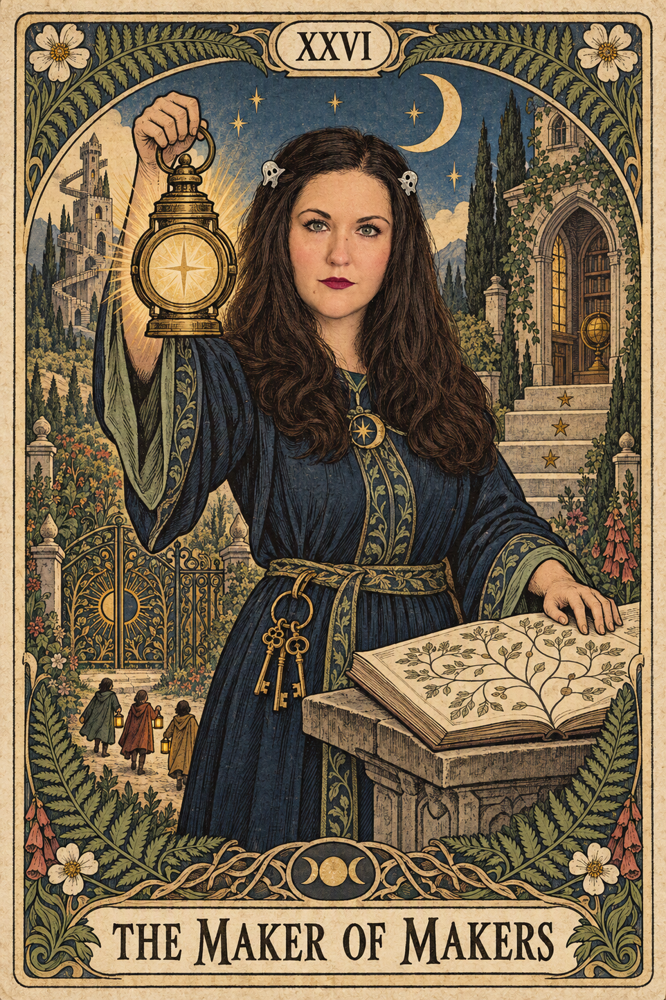
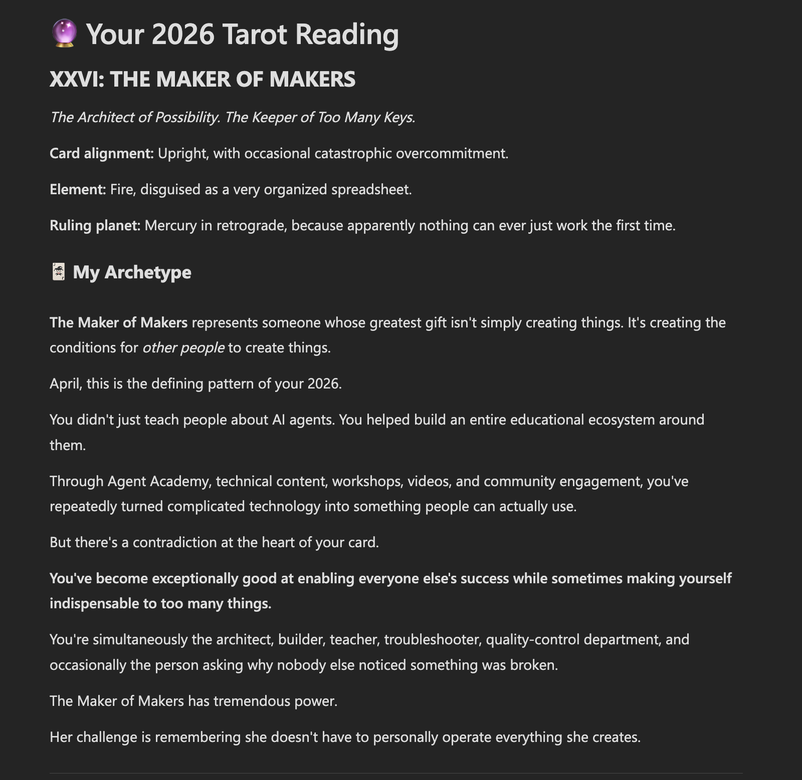
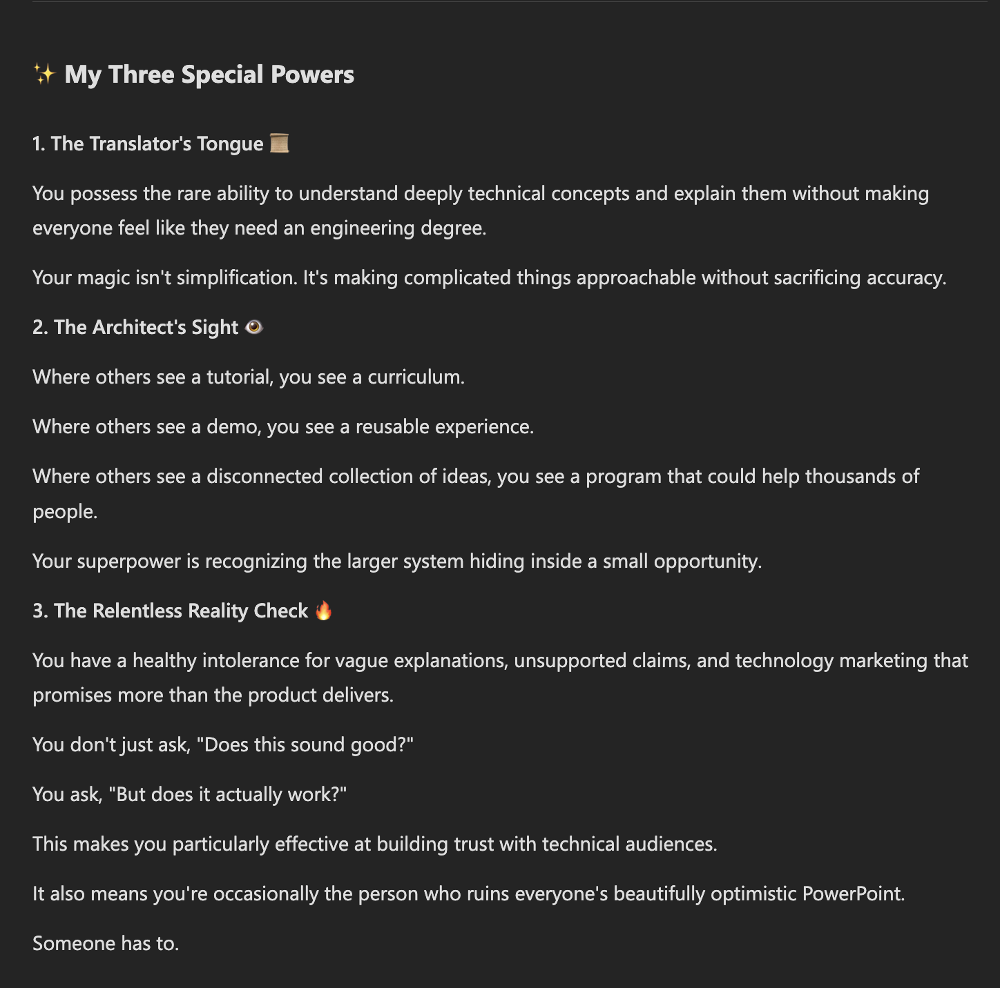
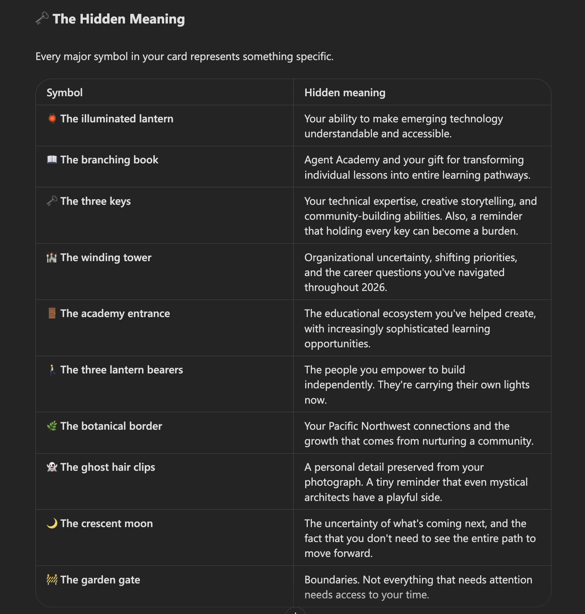
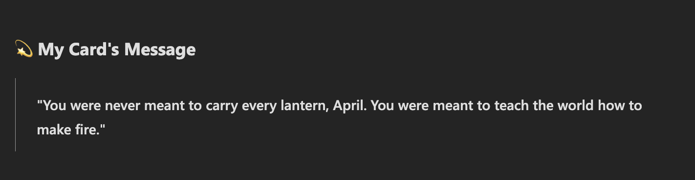

# My Personal Tarot Card



## Summary

Create a personalized 2026 tarot-style card and a separate symbolic reading with Microsoft 365 Copilot. The prompt first requests a photo, uses available personal or professional context to invent an archetype, and combines a vintage illustration with meaningful symbols.

## Prompt

The contributor's prompt is reproduced below as supplied.

```text
# Create My Personalized 2026 Tarot Card

Based on everything you know about me from our previous conversations, saved memories, and personal or professional context, create a **personalized tarot card representing me**.

I want something that feels like a beautiful, collectible tarot card, not a generic AI-generated motivational poster.

## 📸 Step 1: Ask Me to Upload My Photo

**IMPORTANT: Before doing anything else, ask me to upload a clear picture of myself.**

This photo will serve as the visual reference for the central character in my tarot card.

Once uploaded:

- Use my photo to inspire the illustrated character.
- Preserve my recognizable facial features, hairstyle, and overall appearance.
- Transform me into a character that belongs in a traditional tarot deck.
- Do not invent a generic person or substitute someone who doesn't resemble me.

**If I've already attached a photo to this conversation, use it without asking again.**

## 🃏 Step 2: Discover My Archetype

Reflect on what you know about me, including:

- My personality, interests, passions, and quirks
- My professional accomplishments and challenges
- Recurring themes in our conversations
- My strengths, contradictions, and blind spots
- What I've struggled with and overcome
- How I've grown or changed throughout the year

Use these insights to invent a **unique tarot archetype that captures who I really am**.

Give the card a clever, meaningful title. It should feel personal, slightly mystical, and perhaps a little cheeky.

## 🎨 Step 3: Create the Tarot Card Illustration

Create a visually stunning, portrait-oriented tarot card inspired by traditional **Rider-Waite-Smith tarot artwork and vintage Art Nouveau illustrations**.

### Art Direction

- Authentic vintage tarot card aesthetic
- Hand-drawn, woodcut-inspired illustration with bold ink outlines
- Aged parchment background with subtle distressed paper texture
- Muted mustard yellow, dusty blue, terracotta, sage green, and warm cream
- Intricate floral and botanical borders
- Celestial elements such as stars, moons, and sunbursts
- Rich symbolism woven naturally into the scene
- Flat, illustrated colors with subtle printed-paper imperfections
- Beautifully balanced composition with my illustrated likeness as the central figure
- Ornate Roman numeral at the top
- Large, elegant serif card title at the bottom

**IMPORTANT:** Match the visual quality and traditional tarot aesthetic of the reference image, if one is attached.

### What to Avoid

Do NOT create:

- A photorealistic image
- A glossy digital fantasy painting
- A modern infographic
- A corporate illustration

Keep the card visually focused.

Only include the Roman numeral, card title, and a few meaningful words where appropriate.

**Do not put the full tarot reading on the card.**

## 🌙 Step 4: Make Every Symbol Personal

Surround my illustrated character with meaningful objects and imagery representing my actual life and experiences.

These might include:

- Symbols of my accomplishments
- Objects representing my interests or hobbies
- Visual metaphors for my personality
- References to challenges I've faced
- Subtle Easter eggs from our conversations
- Symbols representing my relationships, community, or creative work
- Contrasting imagery showing my strengths and struggles

Don't just fill the image with random mystical decorations.

**Every major object should have a reason for being there.**

Include at least **five meaningful personal symbols** when you have enough information to support them.

Keep the symbolism clever, layered, and visually cohesive.

## 🔮 Step 5: Reveal My Tarot Reading

After generating the card, provide a separate personalized tarot reading containing the following sections.

### 🃏 My Archetype

Explain the card's title and what it reveals about who I've been in 2026.

### ✨ My Three Special Powers

Identify three genuine strengths based on what you know about me.

Make them:

- Specific
- Insightful
- A little playful

### 🌑 My Greatest Weakness

Identify my biggest recurring blind spot or self-defeating pattern.

Ground your interpretation in what you actually know about me.

### 🔮 My New Year Prophecy

Based on the patterns you've observed, offer a creative, slightly mystical prediction about what the new year might hold.

Include:

1. **One opportunity I should embrace**
2. **One trap I should avoid**
3. **One uncomfortable truth I may need to accept**

Frame this as a symbolic interpretation, not a guaranteed prediction.

### 🗝️ The Hidden Meaning

Explain the symbolism and Easter eggs you incorporated into the illustration.

Connect each major symbol to something meaningful from my life, experiences, or conversations.

### 💫 My Card's Message

End with **one memorable, slightly haunting sentence** that captures what I need to hear heading into the new year.

## ✨ Final Creative Direction

The card should feel like something I'd find in an eccentric little metaphysical shop, immediately recognize as myself, and want to frame.

Make it:

- **Beautiful**
- **Personal**
- **Witty**
- **Mystical**
- **Just a little unsettling in how accurately it captures me**​‌
```

## Description

The expected output has two parts: a portrait-oriented illustrated card and a separate reading with six sections. The card should include a Roman numeral, an archetype title, a photo-inspired central figure, and at least five meaningful personal symbols when enough context is available.

The contributor's example is **XXVI: The Maker of Makers**, with a lantern, branching book, keys, botanical borders, and other symbols. It is an original personalized archetype, not a standard card or numbering system in a traditional tarot deck.

## Contributors

[April Dunnam](https://github.com/aprildunnam)

## Version history

| Version | Date | Comments |
| --- | --- | --- |
| 1.0 | November 27, 2026 | Initial release |

## Instructions

1. Open Copilot Chat in the Microsoft 365 Copilot app or at [m365.cloud.microsoft](https://m365.cloud.microsoft/), using an experience that supports image uploads and image generation.
2. Paste the full prompt. If no reference photo is attached, verify that Copilot asks for a clear picture before starting. Upload a photo you have permission to use. If a photo is already attached, the prompt asks Copilot to use it without asking again.
3. Provide a short, non-sensitive summary of your year if Copilot lacks relevant context. Previous chats and saved memories are not necessarily available; do not assume Copilot can access your entire history.
4. If desired, attach a separate, rights-cleared style reference and identify which image is the portrait and which is the style reference.
5. Review the generated card for the requested composition, recognizable illustrated likeness, title, Roman numeral, and at least five supported symbols when sufficient context exists. Request corrections if needed.
6. Review the separate reading for all six requested sections, including exactly three strengths and the opportunity, trap, and uncomfortable truth under the symbolic prophecy. If image generation ends the response before the reading, ask Copilot to provide the reading separately.
7. Check every personal claim and symbol explanation. Treat the reading as creative reflection, not verified facts, a diagnosis, advice for consequential decisions, or a reliable prediction.
8. Before publishing an image or reading, remove personal or confidential information and confirm you have permission to share the photo, references, and contextual details.

### Adapt the prompt

Change `2026` to another year or focus on a project or creative milestone. For a public example, use a fictional persona and an authorized fictional portrait. You can request gentler language for the weakness section or a different vintage palette.

## Prerequisites

- Access to [Microsoft 365 Copilot](https://learn.microsoft.com/copilot/microsoft-365/) with photo uploads and image generation enabled.
- A clear reference photo you have permission to upload and use, plus sufficient context to support personalization.
- Account licensing, feature availability, image-generation limits, and organizational policies that permit the requested use. Saved memories and access to previous conversations depend on the product experience and configuration.
- Permission to use any optional reference artwork. Vintage inspiration is not permission to copy protected reproductions or modern deck artwork.

## Limitations and privacy

- This prompt is for symbolic storytelling and entertainment. The reading does not establish facts about personality, weaknesses, relationships, or future events and should not guide medical, financial, legal, or other consequential decisions.
- Copilot can invent or misinterpret personal details even when asked to ground interpretations. Supply only context you are comfortable using, correct unsupported claims, and avoid sensitive personal information.
- Image generation may not preserve an exact likeness, legible lettering, or every symbol. Refine the result rather than assuming the first output satisfies the prompt.
- The supplied screenshots show the archetype, three strengths, symbol explanations, and final message. They do not show the standalone Greatest Weakness or New Year Prophecy sections, so they are partial output evidence rather than proof of full completion.
- April Dunnam explicitly requested publication of the card and all four reading screenshots. They contain her recognizable likeness, name, and personal or professional interpretations. This permission does not remove the repository's restriction on personal data; inclusion requires maintainer review.

## Example reading screenshots

These contributor-supplied excerpts are unverified creative interpretations, not factual assessments.









## Help

This is a volunteer-maintained community sample, not a Microsoft product. Assistance is provided on a best-effort basis without official Microsoft support or a service-level agreement.

You can try looking at [issues related to this sample](https://github.com/pnp/copilot-prompts/issues?q=label%3A%22sample%3A%20m365-personalized-tarot-card-prompt%22) to see if anybody else is having the same issues.

If you encounter a sample issue or have a suggestion, [create a new issue](https://github.com/pnp/copilot-prompts/issues/new/choose). General Microsoft Copilot product or licensing questions belong in official Microsoft support channels.

## Disclaimer

**SAMPLES AND DOCUMENTATION ARE PROVIDED AS-IS WITHOUT WARRANTY OF ANY KIND, EXPRESS OR IMPLIED, INCLUDING WARRANTIES OF FITNESS FOR A PARTICULAR PURPOSE, MERCHANTABILITY, OR NON-INFRINGEMENT.**


