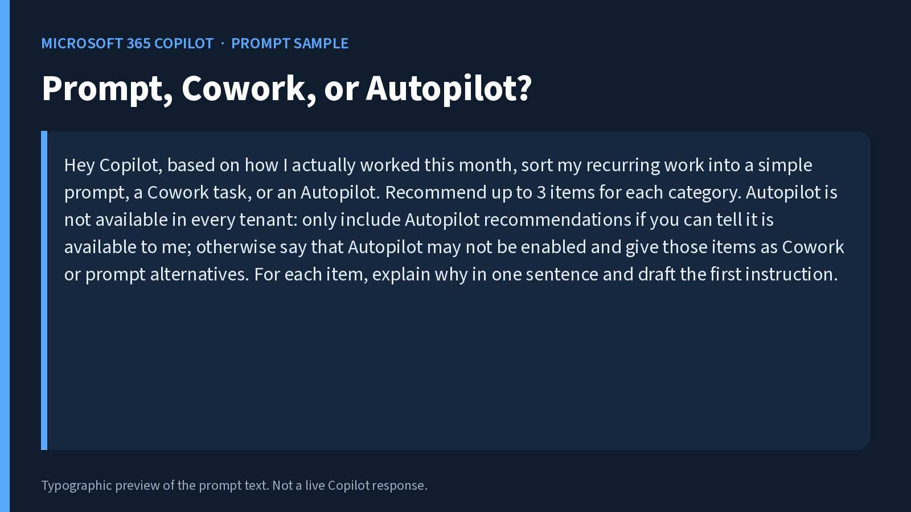

# Prompt, Cowork, or Autopilot?

## Summary

Use Microsoft 365 Copilot and available Work IQ context to sort recurring work into a simple prompt, a Cowork task, or an Autopilot, with fallbacks if Autopilot is not available.

## Prompt 💡

Hey Copilot, based on how I actually worked this month, sort my recurring work into a simple prompt, a Cowork task, or an Autopilot. Recommend up to 3 items for each category. Autopilot is not available in every tenant: only include Autopilot recommendations if you can tell it is available to me; otherwise say that Autopilot may not be enabled and give those items as Cowork or prompt alternatives. For each item, explain why in one sentence and draft the first instruction.

## Description ℹ️

Microsoft 365 Copilot can handle the same work as a quick prompt, a multi-step Cowork task, or a recurring Autopilot, but Autopilot is not available in every tenant. This prompt asks Copilot to look at how you actually worked this month and recommend up to three items for each category. It should include Autopilot recommendations only when that experience appears to be available to you. If Autopilot is not available, Copilot should say so and offer those items as Cowork or prompt alternatives instead. Each recommendation includes a one-sentence rationale and a first instruction you can reuse.

In Microsoft 365 Copilot with work grounding, [Work IQ](https://learn.microsoft.com/microsoft-365/copilot/extensibility/work-iq/) provides work context from sources such as emails, meetings, chats, and files. The response depends on the context available to Copilot and your access permissions; this sample does not require a separate Work IQ integration.

Copilot may not be able to confirm Autopilot availability with certainty. If it is unsure, it should treat Autopilot as unavailable and give Cowork or prompt alternatives. Cowork can be a metered experience, and Autopilot availability depends on your organization's licensing and rollout. Review every recommendation before you schedule, automate, or share it.

### Responsible use and sharing

Use this prompt to plan your own work, not to enable unattended actions that send mail or update records without review. Review and redact every response and screenshot before sharing so no personal information, client or project details, or other confidential information is revealed. Follow your organization's privacy, security, and AI-governance policies, including any rules for Cowork credits and Autopilot.

## Contributors 👨‍💻

[Renato Romão](https://github.com/renatoromao), Microsoft MVP

## Version history

Version|Date|Comments
-------|----|--------
1.0|November 25, 2026|Initial release

## Instructions 📝

1. Sign in with your work account and ensure you have access to Microsoft 365 Copilot with work grounding.
2. Open Microsoft 365 Copilot Chat in Teams or the Microsoft 365 Copilot app, using work mode where available. You can also run this prompt in Cowork if that experience is available to you.
3. Copy and paste the prompt above, then send it.
4. Review the recommendations. If Autopilot is not available in your tenant, use the Cowork or prompt alternatives. Adapt any drafted instruction before you run or schedule it.

### Improvise Usage 🚀

As a follow-up, ask Copilot to focus on calendar work, inbox follow-ups, or a single project. You can also ask it to estimate effort, flag anything that should stay human-owned, or rewrite one Cowork instruction with a clearer output format. If you know Autopilot is not enabled, say so in a follow-up so Copilot skips that category.

## Prerequisites

* [Copilot for Microsoft 365](https://developer.microsoft.com/microsoft-365/dev-program)
* Access to Microsoft 365 Copilot with work grounding, subject to your organization's licensing and configuration.
* Copilot Cowork and Autopilot are optional. This prompt is still useful if you only have Copilot Chat. Autopilot availability varies by tenant and rollout, so the prompt includes fallbacks when Autopilot is not available.

## Help

We do not support samples, but this community is always willing to help, and we want to improve these samples. We use GitHub to track issues, which makes it easy for community members to volunteer their time and help resolve issues.

You can try looking at [issues related to this sample](https://github.com/pnp/copilot-prompts/issues?q=label%3A%22sample%3A%20m365-prompt-cowork-or-autopilot-prompt%22) to see if anybody else is having the same issues.

If you encounter any issues using this sample, [create a new issue](https://github.com/pnp/copilot-prompts/issues/new).

Finally, if you have an idea for improvement, [make a suggestion](https://github.com/pnp/copilot-prompts/issues/new).

## Disclaimer

**THIS CODE IS PROVIDED *AS IS* WITHOUT WARRANTY OF ANY KIND, EITHER EXPRESS OR IMPLIED, INCLUDING ANY IMPLIED WARRANTIES OF FITNESS FOR A PARTICULAR PURPOSE, MERCHANTABILITY, OR NON-INFRINGEMENT.**

