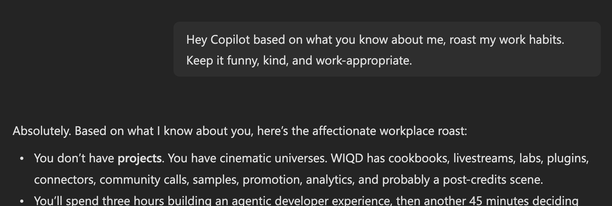

# Roast My Work Habits

## Summary

Get a funny, kind, work-appropriate roast of your work habits using Microsoft 365 Copilot and available Work IQ context.

## Prompt 💡

Hey Copilot based on what you know about me, roast my work habits. Keep it funny, kind, and work-appropriate.

## Description ℹ️

This prompt invites Copilot to turn familiar work habits into lighthearted humor, not a performance assessment. It asks for a kind, work-appropriate response that you can enjoy privately or review before sharing with colleagues.

In Microsoft 365 Copilot with work grounding, [Work IQ](https://learn.microsoft.com/microsoft-365/copilot/extensibility/work-iq/) provides work context from sources such as emails, meetings, chats, and files. The response depends on the context available to Copilot and your access permissions; this sample does not require a separate Work IQ integration.

Copilot may misinterpret habits or produce generic jokes when context is limited. Review the response for accuracy, tone, and confidential information before sharing. Keep humor focused on work habits, not sensitive personal characteristics.

### Responsible use and sharing

Use this prompt for friendly, work-appropriate humor, not to embarrass or target others. Review and redact every response and screenshot before sharing so no personal information, client or project details, or other confidential information is revealed. Follow your organization's privacy and information-sharing policies.

## Contributors 👨‍💻

[RicksterCDN](https://github.com/RicksterCDN)

> Contributed by Rick and inspired by an existing prompt. The original author is currently unknown, and we'd be happy to add attribution if identified.

## Version history

Version|Date|Comments
-------|----|--------
1.0|November 24, 2026|Initial release

## Instructions 📝

1. Sign in with your work account and ensure you have access to Microsoft 365 Copilot with work grounding.
2. Open Microsoft 365 Copilot Chat in Teams or the Microsoft 365 Copilot app, using work mode where available.
3. Copy and paste the prompt above, then send it.
4. Expect a lighthearted roast based on the context Copilot can access. Review it before sharing and ask for a gentler version if needed.

### Improvise Usage 🚀

As a follow-up, ask Copilot to focus on meeting habits, inbox management, or calendar overload. You can also ask for three short jokes or a friendly improvement tip after each joke. Avoid supplying confidential details or asking it to roast colleagues.

## Prerequisites

* [Copilot for Microsoft 365](https://developer.microsoft.com/microsoft-365/dev-program)
* Access to Microsoft 365 Copilot with work grounding, subject to your organization's licensing and configuration.

## Help

We do not support samples, but this community is always willing to help, and we want to improve these samples. We use GitHub to track issues, which makes it easy for community members to volunteer their time and help resolve issues.

You can try looking at [issues related to this sample](https://github.com/pnp/copilot-prompts/issues?q=label%3A%22sample%3A%20m365-roast-my-work-habits-prompt%22) to see if anybody else is having the same issues.

If you encounter any issues using this sample, [create a new issue](https://github.com/pnp/copilot-prompts/issues/new).

Finally, if you have an idea for improvement, [make a suggestion](https://github.com/pnp/copilot-prompts/issues/new).

## Disclaimer

**THIS CODE IS PROVIDED *AS IS* WITHOUT WARRANTY OF ANY KIND, EITHER EXPRESS OR IMPLIED, INCLUDING ANY IMPLIED WARRANTIES OF FITNESS FOR A PARTICULAR PURPOSE, MERCHANTABILITY, OR NON-INFRINGEMENT.**

