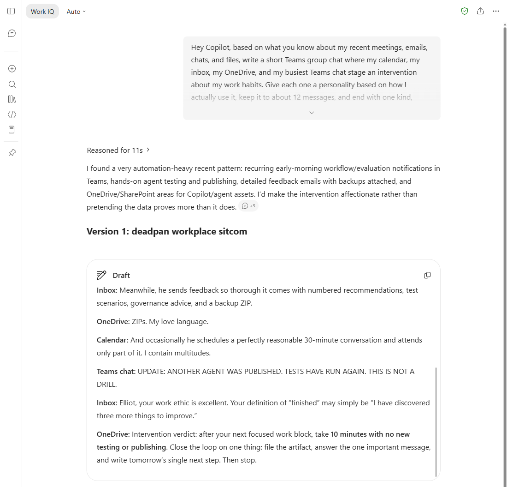

# My Work Apps Stage an Intervention

## Summary

Have Microsoft 365 Copilot write a short, funny Teams group chat in which your calendar, inbox, OneDrive, and busiest Teams chat stage an intervention about your work habits, then end with one practical suggestion.

## Prompt 💡

Hey Copilot, based on what you know about my recent meetings, emails, chats, and files, write a short Teams group chat where my calendar, my inbox, my OneDrive, and my busiest Teams chat stage an intervention about my work habits. Give each one a personality based on how I actually use it, keep it to about 12 messages, and end with one kind, practical suggestion. Keep it funny, kind, and work-appropriate, and do not name colleagues.

## Description ℹ️

The apps you live in all day know your habits better than anyone. This prompt gives each of them a voice: the calendar that never finds a free hour, the inbox full of automated notices, the Teams chat that will not stop posting. They take turns confronting you in a group chat, and the last message turns the joke into one small, practical change.

In Microsoft 365 Copilot with work grounding, [Work IQ](https://learn.microsoft.com/microsoft-365/copilot/extensibility/work-iq/) provides work context from sources such as emails, meetings, chats, and files. When we tried it, Copilot first summarized the patterns it found (recurring notifications in a Teams chat, the kind of emails being sent, what lives in OneDrive), then wrote the chat with a distinct personality for each app, and closed with a concrete focus tip. It also offered a second version in a different tone. The response depends on the context available to Copilot and your access permissions; this sample does not require a separate Work IQ integration.

Asking it not to name colleagues keeps the cast to your own apps. When context is limited, the personalities get more generic, so the prompt works best for someone with a few weeks of real activity.

### Responsible use and sharing

Use this prompt for friendly, work-appropriate humor about your own habits, not to embarrass or target others. Review and redact every response and screenshot before sharing so no personal information, client or project details, file names, or other confidential information is revealed. Follow your organization's privacy and information-sharing policies.

## Contributors 👨‍💻

[Elliot Margot](https://github.com/OwnOptic)

## Version history

Version|Date|Comments
-------|----|--------
1.0|November 28, 2026|Initial release

## Instructions 📝

1. Sign in with your work account and ensure you have access to Microsoft 365 Copilot with work grounding.
2. Open Microsoft 365 Copilot Chat in Teams or the Microsoft 365 Copilot app, using work mode where available.
3. Copy and paste the prompt above, then send it.
4. Expect a short group chat between your apps, based on the context Copilot can access, ending with one suggestion. Review it before sharing.

### Improvise Usage 🚀

Swap the cast for the apps you actually use most, such as Planner, Loop, or a busy SharePoint site. Ask for a version where the apps are on your side instead, or for the same chat written as a sitcom script. You can also ask Copilot to turn the closing suggestion into a recurring focus block on your calendar.

## Prerequisites

* [Copilot for Microsoft 365](https://developer.microsoft.com/microsoft-365/dev-program)
* Access to Microsoft 365 Copilot with work grounding, subject to your organization's licensing and configuration.

## Help

We do not support samples, but this community is always willing to help, and we want to improve these samples. We use GitHub to track issues, which makes it easy for community members to volunteer their time and help resolve issues.

You can try looking at [issues related to this sample](https://github.com/pnp/copilot-prompts/issues?q=label%3A%22sample%3A%20m365-work-habits-intervention-prompt%22) to see if anybody else is having the same issues.

If you encounter any issues using this sample, [create a new issue](https://github.com/pnp/copilot-prompts/issues/new).

Finally, if you have an idea for improvement, [make a suggestion](https://github.com/pnp/copilot-prompts/issues/new).

## Disclaimer

**THIS CODE IS PROVIDED *AS IS* WITHOUT WARRANTY OF ANY KIND, EITHER EXPRESS OR IMPLIED, INCLUDING ANY IMPLIED WARRANTIES OF FITNESS FOR A PARTICULAR PURPOSE, MERCHANTABILITY, OR NON-INFRINGEMENT.**

