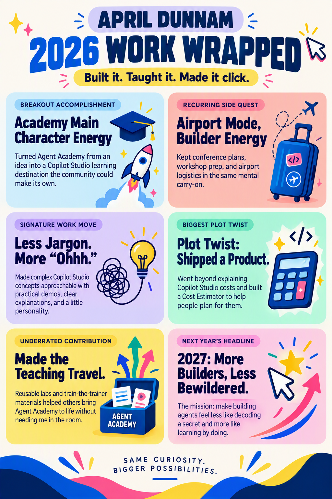

# My Work Year, Wrapped



## Summary

Create a colorful, witty six-card visual recap of your work year with Microsoft 365 Copilot. Highlight accomplishments, recurring challenges, signature habits, unexpected developments, underrated contributions, and a headline for next year.

## Prompt

```text
Based on the work context available, create my 2026 Work Wrapped visual: a colorful, witty, six-card year-in-review. Include my breakout accomplishment, recurring side quest, signature work move, biggest plot twist, underrated contribution, and a headline for next year. Give each card a punchy title and one memorable sentence. Ground observations in available evidence; don’t invent statistics or imply you reviewed data you cannot access. Make it celebratory, lightly funny, and suitable for sharing.
```

## Description

The prompt turns available work context into a visual year-in-review, asking for six cards with concise titles and supporting sentences. It explicitly asks Copilot not to invent statistics or claim access to unavailable data.

The contributor-supplied example uses a two-column, three-row card layout under the heading **2026 Work Wrapped** and the tagline **Built it. Taught it. Made it click.** Its cards cover Agent Academy, travel, approachable explanations, a cost estimator, reusable teaching materials, and a forward-looking headline. These are example output claims, not independently verified facts or a template for other users' accomplishments.

## Contributors

[April Dunnam](https://github.com/aprildunnam)

## Version history

| Version | Date | Comments |
| --- | --- | --- |
| 1.0 | November 27, 2026 | Initial release |

## Instructions

1. Open Copilot Chat in the Microsoft 365 Copilot app or at [m365.cloud.microsoft](https://m365.cloud.microsoft/).
2. Use an experience with work grounding and image generation available, subject to your account permissions and organizational policies. If context is limited, first supply a short, non-sensitive summary of your year.
3. Paste the prompt above and send it.
4. Review the visual for all six requested categories, a punchy title and one memorable sentence per card, and accurate, evidence-supported observations.
5. If Copilot returns only a written concept, ask it to generate the six-card visual from that concept, provided image generation is available. Ask for clearer text or corrected details if necessary.
6. Before sharing, remove personal or confidential information, confirm claims about your work, and check that you have permission to publish any referenced details.

### Adapt the prompt

Replace `2026` with another year or specify a project, semester, or quarter. Ask for fictional examples and no names when creating a public sample. You can request a different color palette or six separate cards instead of a single visual.

## Prerequisites

- Access to [Microsoft 365 Copilot](https://learn.microsoft.com/copilot/microsoft-365/) with image generation enabled.
- Available work context or a user-supplied summary. Copilot's access depends on permissions and configuration; it cannot be assumed to review every email, meeting, or previous conversation.
- Licensing, feature availability, image-generation limits, and organizational policies that permit the requested use.

## Limitations and privacy

- Evidence-grounding instructions do not guarantee factual accuracy. Copilot can misinterpret context or invent details; this is a creative reflection, not a verified performance assessment.
- The next-year headline is a creative aspiration, not an evidence-backed prediction.
- Generated images may contain spelling errors, illegible text, missing cards, or more text than requested. Review and refine the output.
- April Dunnam supplied the PNG and requested its inclusion in this public contribution. It contains her name and personalized work details. Inclusion requires maintainer review under the repository's restriction on personal data; contributor authorization does not remove that restriction.
- Use only information you have permission to share. Prefer fictional or non-identifying public examples and follow your organization's privacy and information-sharing policies.

## Help

This is a volunteer-maintained community sample, not a Microsoft product. Assistance is provided on a best-effort basis without official Microsoft support or a service-level agreement.

You can try looking at [issues related to this sample](https://github.com/pnp/copilot-prompts/issues?q=label%3A%22sample%3A%20m365-work-year-wrapped-prompt%22) to see if anybody else is having the same issues.

If you encounter a sample issue or have a suggestion, [create a new issue](https://github.com/pnp/copilot-prompts/issues/new/choose). General Microsoft Copilot product or licensing questions belong in official Microsoft support channels.

## Disclaimer

**SAMPLES AND DOCUMENTATION ARE PROVIDED AS-IS WITHOUT WARRANTY OF ANY KIND, EXPRESS OR IMPLIED, INCLUDING WARRANTIES OF FITNESS FOR A PARTICULAR PURPOSE, MERCHANTABILITY, OR NON-INFRINGEMENT.**


