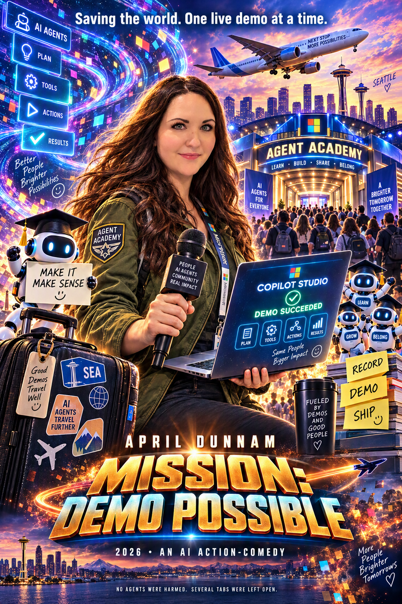

# Turn your year into a blockbuster movie poster



## Summary

Turn your 2026 into a dramatic, funny, over-the-top movie poster with Microsoft 365 Copilot. The prompt asks Copilot to choose a genre, invent a hilarious but accurate title and tagline, and represent your challenges, accomplishments, and personality visually.

## Prompt

```text
Based on what you know about me, imagine my 2026 as a blockbuster movie. Create a cinematic movie poster with a hilarious but accurate title, a tagline that captures my year, and visual elements representing my biggest challenges, accomplishments, and personality. Choose the movie genre that best fits my year. Make it dramatic, funny, and ridiculously over-the-top.
```

## Description

This creative reflection prompt uses the context available to Copilot to turn a year into a cinematic story. The expected output is a generated poster with a personalized title, a tagline, a genre, and visual references to the user's year.

The contributor-provided example is an AI action-comedy titled **Mission: Demo Possible**, with the tagline **Saving the world. One live demo at a time.** Its visuals combine public speaking, AI agents, learning, travel, and live demos. This is an example output, not a promise that Copilot will produce the same title, likeness, or composition.

## Contributors

[April Dunnam](https://github.com/aprildunnam)

## Version history

| Version | Date | Comments |
| --- | --- | --- |
| 1.0 | November 27, 2026 | Initial release |

## Instructions

1. Open Copilot Chat in the Microsoft 365 Copilot app or at [m365.cloud.microsoft](https://m365.cloud.microsoft/).
2. If Copilot has insufficient context about your year, first provide a short, non-sensitive summary of your challenges, accomplishments, interests, and personality. Do not assume Copilot remembers every previous conversation or can access all your work.
3. Paste the prompt above and send it.
4. Review the generated title, tagline, genre, and poster. If Copilot returns only a written concept, ask it to generate the poster image using that concept, provided image generation is available.
5. Refine the result as needed, for example by asking for a different genre, clearer lettering, or a stronger focus on a particular accomplishment.
6. Before sharing an output, check it for inaccurate claims, personal information, confidential work details, and names or likenesses you do not have permission to publish.

### Adapt the prompt

Replace `2026` with another year, or describe a specific period such as a project, a semester, or a career milestone. You can also specify a genre or request fictional characters and non-identifying visual elements for a shareable version.

## Prerequisites

- Access to [Microsoft 365 Copilot](https://learn.microsoft.com/copilot/microsoft-365/) and a Copilot Chat experience with image generation enabled.
- Product access, licensing, image-generation limits, and organizational policies must permit the requested use. Availability can vary by account and environment; the prompt does not grant access to unavailable features.
- Enough context for Copilot to personalize the result. A reference photo is optional and should only be supplied if you have permission to use it.

## Limitations and privacy

- Copilot can invent details or misinterpret your year. Treat the result as a creative reflection, not a factual biography or performance assessment.
- Generated text, faces, logos, and visual details may contain errors. A recognizable likeness is not guaranteed.
- The sample PNG was supplied by April Dunnam, who explicitly authorized using it in this public contribution. It contains her name and recognizable likeness. That authorization does not remove the repository's restriction on personal data; inclusion requires maintainer review.
- Use only context and images you have the right to share. Prefer fictional or non-identifying outputs for public examples, and follow your organization's security, privacy, and responsible AI requirements.

## Help

This is a volunteer-maintained community sample, not a Microsoft product. Assistance is provided on a best-effort basis without official Microsoft support or a service-level agreement.

You can try looking at [issues related to this sample](https://github.com/pnp/copilot-prompts/issues?q=label%3A%22sample%3A%20m365-year-as-blockbuster-movie-poster-prompt%22) to see if anybody else is having the same issues.

If you encounter a sample issue or have a suggestion, [create a new issue](https://github.com/pnp/copilot-prompts/issues/new/choose). General Microsoft Copilot product or licensing questions belong in official Microsoft support channels.

## Disclaimer

**SAMPLES AND DOCUMENTATION ARE PROVIDED AS-IS WITHOUT WARRANTY OF ANY KIND, EXPRESS OR IMPLIED, INCLUDING WARRANTIES OF FITNESS FOR A PARTICULAR PURPOSE, MERCHANTABILITY, OR NON-INFRINGEMENT.**


