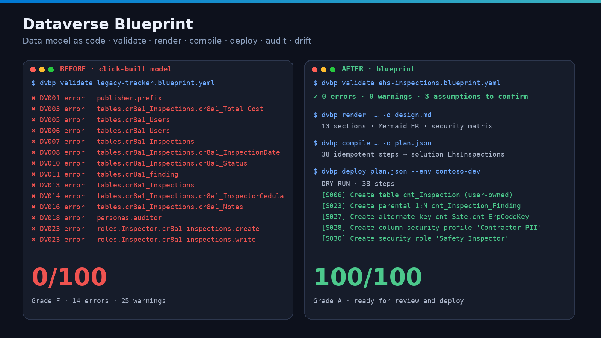

# Dataverse Blueprint — Data Model as Code (GitHub Copilot Skill)



## Summary

A GitHub Copilot agent skill that treats a **Microsoft Dataverse data model as code**. Copilot turns a business process into a reviewable `*.blueprint.yaml`; a bundled zero-dependency CLI then **validates** it against 30 architecture rules with a score, **renders** the design document (Mermaid ER, column dictionary, security matrix), **compiles** an ordered and idempotent Dataverse Web API deployment plan, **deploys** it inside a solution, **exports** an existing environment back to a blueprint for auditing, and **diffs** repository vs. environment to catch drift. It ships with a GitHub Actions workflow that reviews every model change in pull requests with inline annotations.

It is the successor of [Dataverse Schema Architect](../dataverse-schema-architect/): same architectural judgment, now enforced by code and carried all the way to the environment.

## Skill

The definition is in [SKILL.md](./SKILL.md). Copy the **whole folder** (it includes `scripts/`, `references/`, `examples/` and `ci/`) to `.github/skills/dataverse-blueprint/` in your repository, or install it as a personal skill in `~/.copilot/skills/dataverse-blueprint/`.

### Trigger Phrases

- "Design the Dataverse data model for this process"
- "Deploy this data model to my dev environment"
- "Audit our Dataverse environment, prefix cnt"
- "Add a supplier table to the model and deploy the change"
- "Is our dev environment in sync with the blueprint?"
- "Diseña / despliega / audita el modelo de datos en Dataverse" *(works in Spanish too)*

## Description

Most Dataverse projects fail quietly at the data model: custom "Users" tables, ownership that can't be changed later, date columns that shift a day across time zones, PII without column security, roles with Organization-wide delete. A good design document helps — but documents don't stop anyone from clicking the wrong thing in the maker portal, and they drift from the environment after the first sprint.

This skill closes that loop:

| | Design doc only | Plan Designer / Dataverse MCP `create_table` | **Dataverse Blueprint** |
|---|---|---|---|
| Architect-level decisions (ownership, date behavior, cascade, depth) | ✔ | partial | ✔ |
| Deterministic validation with rule IDs and score | — | — | ✔ 30 rules (DV001–DV030) |
| Reviewable in a pull request, with inline annotations | — | — | ✔ SARIF + GitHub Action |
| Relationships with cascade, alternate keys, column security, role privileges deployed | — | partial | ✔ via Web API plan |
| Idempotent re-runs, everything inside a named solution | — | — | ✔ |
| Audit an existing environment | — | — | ✔ `export` + `validate` |
| Drift detection repo ↔ environment | — | — | ✔ `diff` |

### The workflow

```text
process ──Copilot──▶ blueprint.yaml ──validate──▶ score + findings ──render──▶ design.md
                           │                                                   (Mermaid, matrix, checklist)
                           └──compile──▶ plan.json ──deploy --check/--apply──▶ Dev environment (inside the solution)
Dev environment ──export──▶ live.yaml ──validate / diff──▶ audit report · drift
```

### What's in the folder

| Path | What it is |
|---|---|
| `SKILL.md` | Instructions Copilot follows (4 modes: Design, Deploy, Audit, Evolve) |
| `scripts/dvbp.py` | The CLI. Python 3.9+, standard library only (PyYAML for `.yaml`; `.json` blueprints need nothing) |
| `references/` | Blueprint spec, design rules, rule catalog — loaded by Copilot on demand |
| `examples/ehs-inspections.*` | A complete EHS inspections model: blueprint, generated design document, generated 38-step plan |
| `examples/legacy-tracker.*` | The "before" picture: a click-built model that scores 0/100 with 14 errors |
| `ci/dataverse-blueprint.yml` | GitHub Actions workflow: validate + SARIF annotations + stale-document check (+ optional nightly drift) |
| `tests/` | 11 unit tests (`python -m unittest discover -s tests`) |

### Try it in 30 seconds (no environment needed)

```bash
cd .github/skills/dataverse-blueprint
python scripts/dvbp.py validate examples/legacy-tracker.blueprint.yaml      # Score 0/100 · 14 errors
python scripts/dvbp.py validate examples/ehs-inspections.blueprint.yaml     # Score 100/100 · Grade A
python scripts/dvbp.py render   examples/ehs-inspections.blueprint.yaml -o design.md
python scripts/dvbp.py compile  examples/ehs-inspections.blueprint.yaml -o plan.json
python scripts/dvbp.py deploy   plan.json --env https://contoso-dev.crm.dynamics.com   # dry-run by default
```

### Versión en español

Este skill trata el modelo de datos de **Microsoft Dataverse como código**. Copilot convierte un proceso de negocio en un `blueprint.yaml` revisable; un CLI incluido, sin dependencias, lo **valida** contra 30 reglas de arquitectura con puntaje, **genera** el documento de diseño (diagrama ER en Mermaid, diccionario de columnas, matriz de seguridad), **compila** un plan de despliegue ordenado e idempotente para la Web API, lo **despliega** dentro de una solución, **exporta** un entorno existente para auditarlo y **compara** repositorio contra entorno para detectar drift. Incluye un workflow de GitHub Actions que revisa cada cambio del modelo en los pull requests. Si le escribes en español, responde en español; los nombres de esquema se mantienen en inglés ASCII.

## Contributors

[Roger Carias](https://github.com/rogerscarias)

## Version history

Version|Date|Comments
-------|----|--------
1.0|November 17, 2026|Initial release

## Instructions

1. Copy this folder to `.github/skills/dataverse-blueprint/` in your repository.
2. Open GitHub Copilot Chat in VS Code (Agent mode) or the Copilot CLI.
3. Describe your process, or ask for an audit of an existing environment.
4. Review the generated `design.md`, resolve every `[DECIDE]` item, and approve.
5. To deploy: `az login` with an account that is System Customizer (or higher) in a **development** environment, then let Copilot run `deploy --check` and, after your confirmation, `deploy --apply`.
6. Optional: copy `ci/dataverse-blueprint.yml` to `.github/workflows/` so every model change is reviewed in pull requests.

### Customization

- **Naming and rules**: rules live in `RULES` and `validate()` in `scripts/dvbp.py`; add your organization's own (e.g. mandatory `cnt_ExternalId` on integrated tables) and document them in `references/rule-catalog.md`.
- **Compliance**: extend PII detection and the column security defaults with your regulation (GDPR, LGPD, Ley 1581, HIPAA).
- **Pipelines**: run `validate` and `diff --fail-on-drift` in Azure DevOps the same way as the GitHub workflow.

### Limits (by design)

- Formula columns, status reasons, forms and views are emitted as **manual** steps: formula columns can only be authored in the Power Apps maker portal.
- `export` covers custom tables, columns, date behavior, global choices, alternate keys and custom N:1 relationships; security roles are reviewed separately.
- `deploy` targets development environments; test and production receive the **managed** solution through your ALM pipeline.

## Prerequisites

* [GitHub Copilot](https://github.com/features/copilot) with agent skills (VS Code agent mode, Copilot CLI or Copilot coding agent)
* Python 3.9+ (`pip install pyyaml` for YAML blueprints)
* For Deploy / Audit: a Power Platform **development** environment with Dataverse and [Azure CLI](https://learn.microsoft.com/cli/azure/install-azure-cli) (`az login`) or a token in `DATAVERSE_TOKEN`
* Optional: [Power Platform CLI (`pac`)](https://learn.microsoft.com/power-platform/developer/cli/introduction) for solution export/unpack

## Help

We do not support samples, but this community is always willing to help, and we want to improve these samples. We use GitHub to track issues, which makes it easy for community members to volunteer their time and help resolve issues.

You can try looking at [issues related to this sample](https://github.com/pnp/copilot-prompts/issues?q=label%3A%22sample%3A%20dataverse-blueprint%22) to see if anybody else is having the same issues.

If you encounter any issues using this sample, [create a new issue](https://github.com/pnp/copilot-prompts/issues/new).

Finally, if you have an idea for improvement, [make a suggestion](https://github.com/pnp/copilot-prompts/issues/new).

## Disclaimer

**THIS CODE IS PROVIDED *AS IS* WITHOUT WARRANTY OF ANY KIND, EITHER EXPRESS OR IMPLIED, INCLUDING ANY IMPLIED WARRANTIES OF FITNESS FOR A PARTICULAR PURPOSE, MERCHANTABILITY, OR NON-INFRINGEMENT.**

---

