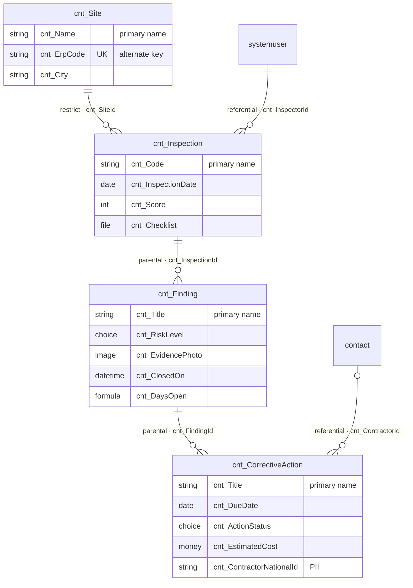

# EHS Inspections — Data Model Design

> Generated by `dvbp render` from the blueprint — do not edit by hand. Blueprint score **100/100 (A)**.

## 1. Summary

Monthly safety inspections per plant. Inspectors record findings with a risk level and photo evidence; each finding gets corrective actions assigned to an employee or an external contractor. Plant managers see only their plant (business unit per plant); the safety director sees everything. Plants come from the ERP and are upserted nightly through an alternate key.

- **Solution** `EhsInspections` v1.0.0.0 · publisher `contosoehs` (prefix `cnt_`, option values 10000xxxx)
- **4 custom tables**, 2 global choices, 5 relationships, 3 security roles

## 2. Assumptions & Open Questions

1. `[ASSUMED]` One business unit per plant, created and maintained by IT (not by this solution).
2. `[ASSUMED]` Contractors are stored as standard Contact rows linked to their company (Account).
3. `[DECIDE]` Should closed inspections become read-only for inspectors (business rule vs. status-based security)?
4. `[DECIDE]` Retention period for evidence photos (affects File/Image storage capacity).
5. `[ASSUMED]` Column cnt_EstimatedCost is an assumption: confirm with the business.
6. `[ASSUMED]` Column cnt_Score is an assumption: confirm with the business.
7. `[ASSUMED]` Column cnt_City is an assumption: confirm with the business.

## 3. Entity-Relationship Diagram

## 4. Table Catalog

| Display name | Schema name | Type | Ownership | Primary name column | Purpose | Est. volume/yr | Audit |
|---|---|---|---|---|---|---|---|
| Site | `cnt_Site` | Standard | User/Team | `cnt_Name` | Plant master data synced from the ERP | < 100 | Yes |
| Inspection | `cnt_Inspection` | Standard | User/Team | `cnt_Code` Autonumber `INS-{SEQNUM:6}` | Monthly inspection header (one per plant per month) | ~1,200 | Yes |
| Finding | `cnt_Finding` | Standard | User/Team | `cnt_Title` | Each non-conformity found during an inspection | ~6,000 | Yes |
| Corrective Action | `cnt_CorrectiveAction` | Standard | User/Team | `cnt_Title` | Action that closes a finding, assigned to an employee or a contractor | ~8,000 | Yes |

## 5. Column Dictionary

### Site (`cnt_Site`)

| Display name | Schema name | Data type / format | Required | Searchable | Notes |
|---|---|---|---|---|---|
| ERP code | `cnt_ErpCode` | Text (20) | Yes | Yes |  |
| City | `cnt_City` | Text (80) | No | No | `[ASSUMED]` |

### Inspection (`cnt_Inspection`)

| Display name | Schema name | Data type / format | Required | Searchable | Notes |
|---|---|---|---|---|---|
| Inspection date | `cnt_InspectionDate` | Date only · Date Only | Yes | No |  |
| Score | `cnt_Score` | Whole number | No | No | `[ASSUMED]` 0-100 checklist compliance |
| Signed checklist | `cnt_Checklist` | File (max 10240 KB) | No | No |  |
| Site | `cnt_SiteId` | Lookup → `cnt_Site` | Yes | Yes | Restrict |
| Inspector | `cnt_InspectorId` | Lookup → `systemuser` | Yes | Yes | Referential |

### Finding (`cnt_Finding`)

| Display name | Schema name | Data type / format | Required | Searchable | Notes |
|---|---|---|---|---|---|
| Risk level | `cnt_RiskLevel` | Choice → `cnt_risklevel` | Yes | Yes |  |
| Evidence photo | `cnt_EvidencePhoto` | Image | No | No |  |
| Closed on | `cnt_ClosedOn` | Date and time · User Local | No | No |  |
| Days open | `cnt_DaysOpen` | Formula (Whole number) | No | No | `DateDiff(createdon, If(IsBlank('Closed on'), Now(), 'Closed on'), TimeUnit.Days)` createdon and Closed on are User Local, so Now() (not UTCNow()) |
| Inspection | `cnt_InspectionId` | Lookup → `cnt_Inspection` | Yes | Yes | Parental |

### Corrective Action (`cnt_CorrectiveAction`)

| Display name | Schema name | Data type / format | Required | Searchable | Notes |
|---|---|---|---|---|---|
| Due date | `cnt_DueDate` | Date only · Date Only | Yes | No |  |
| Action status | `cnt_ActionStatus` | Choice → `cnt_actionstatus` | Yes | No |  |
| Estimated cost | `cnt_EstimatedCost` | Currency | No | No | `[ASSUMED]` |
| Contractor national ID | `cnt_ContractorNationalId` | Text (30) | No | No | 🔒 PII · Required by labor-safety regulation for external workers |
| Finding | `cnt_FindingId` | Lookup → `cnt_Finding` | Yes | Yes | Parental |
| Contractor | `cnt_ContractorId` | Lookup → `contact` | No | Yes | Referential |

## 6. Choices

| Choice | Options (label → value) | Used by |
|---|---|---|
| `cnt_risklevel` | Low 100000000, Medium 100000001, High 100000002, Critical 100000003 | `cnt_Finding.cnt_RiskLevel` |
| `cnt_actionstatus` | Open 100000000, In progress 100000001, Done 100000002, Verified 100000003 | `cnt_CorrectiveAction.cnt_ActionStatus` |

## 7. Relationships

| Schema name | Type | Parent → Child | Lookup | Behavior | Cascade (Assign/Delete/Reparent/Share) |
|---|---|---|---|---|---|
| `cnt_Site_Inspection` | 1:N | `cnt_Site` → `cnt_Inspection` | `cnt_SiteId` | Restrict | NoCascade/Restrict/NoCascade/NoCascade |
| `cnt_Inspection_Finding` | 1:N | `cnt_Inspection` → `cnt_Finding` | `cnt_InspectionId` | Parental | Cascade/Cascade/Cascade/Cascade |
| `cnt_Finding_CorrectiveAction` | 1:N | `cnt_Finding` → `cnt_CorrectiveAction` | `cnt_FindingId` | Parental | Cascade/Cascade/Cascade/Cascade |
| `cnt_systemuser_Inspection_Inspector` | 1:N | `systemuser` → `cnt_Inspection` | `cnt_InspectorId` | Referential | NoCascade/RemoveLink/NoCascade/NoCascade |
| `cnt_contact_CorrectiveAction_Contractor` | 1:N | `contact` → `cnt_CorrectiveAction` | `cnt_ContractorId` | Referential | NoCascade/RemoveLink/NoCascade/NoCascade |

## 8. Alternate Keys

- `cnt_Site.cnt_ErpCodeKey` on (cnt_ErpCode) — nightly upsert from ERP. The index builds asynchronously: wait for status **Active** before the first upsert.

## 9. Security Model

Depth: `—` None · `U` User · `B` Business Unit · `P` Parent:Child BU · `O` Organization. Order per cell: C R W D A AT Asg Sh.

| Role \ Table | `cnt_CorrectiveAction` | `cnt_Finding` | `cnt_Inspection` | `cnt_Site` | `contact` |
|---|---|---|---|---|---|
| **Safety Inspector** | `U B U — B — — —` | `U B U — B B — —` | `U B U — B B — —` | `— B — — — B — —` | `— O — — — O — —` |
| **Plant Manager** | `B B B — B — B —` | `— B — — — B — —` | `— B — — — — — —` | `— B — — — — — —` | `— O — — — O — —` |
| **Safety Director** | `O O O O O — O O` | `— O O — O O — —` | `— O O — O O O —` | `— O O — — O — —` | `— O — — — O — —` |

- **Column security profile `Contractor PII`** — columns `cnt_CorrectiveAction.cnt_ContractorNationalId`; read ✔, create ✔, update ✖; granted to Safety Director (Entra ID group team)
- Roles are assigned to Microsoft Entra ID group teams per plant, never user by user.

## 10. Solution & ALM

- Unmanaged solution `EhsInspections` in development, **managed** in test/production.
- Environment variable `cnt_ErpBaseUrl`
- Connection reference `cnt_ErpConnection`
- Export with `pac solution export` + `pac solution unpack` and commit next to this blueprint.
- Deploy with `dvbp compile` → `dvbp deploy --apply` (idempotent; every component is added to the solution).

## 11. Build Checklist

1. [ ] Create publisher 'contosoehs' (prefix cnt)
2. [ ] Create unmanaged solution 'EhsInspections'
3. [ ] Create global choice cnt_risklevel
4. [ ] Create global choice cnt_actionstatus
5. [ ] Create table cnt_Site (user-owned)
6. [ ] Create table cnt_Inspection (user-owned)
7. [ ] Create table cnt_Finding (user-owned)
8. [ ] Create table cnt_CorrectiveAction (user-owned)
9. [ ] Add column cnt_Site.cnt_ErpCode (Text (20))
10. [ ] Add column cnt_Site.cnt_City (Text (80))
11. [ ] Add column cnt_Inspection.cnt_InspectionDate (Date only · Date Only)
12. [ ] Add column cnt_Inspection.cnt_Score (Whole number)
13. [ ] Add column cnt_Inspection.cnt_Checklist (File (max 10240 KB))
14. [ ] Add column cnt_Finding.cnt_RiskLevel (Choice → `cnt_risklevel`)
15. [ ] Add column cnt_Finding.cnt_EvidencePhoto (Image)
16. [ ] Add column cnt_Finding.cnt_ClosedOn (Date and time · User Local)
17. [ ] Create formula column cnt_Finding.cnt_DaysOpen in the maker portal: DateDiff(createdon, If(IsBlank('Closed on'), Now(), 'Closed on'), TimeUnit.Days) — **manual**
18. [ ] Add column cnt_CorrectiveAction.cnt_DueDate (Date only · Date Only)
19. [ ] Add column cnt_CorrectiveAction.cnt_ActionStatus (Choice → `cnt_actionstatus`)
20. [ ] Add column cnt_CorrectiveAction.cnt_EstimatedCost (Currency)
21. [ ] Add column cnt_CorrectiveAction.cnt_ContractorNationalId (Text (30))
22. [ ] Create restrict 1:N cnt_Site_Inspection (cnt_Site → cnt_Inspection)
23. [ ] Create parental 1:N cnt_Inspection_Finding (cnt_Inspection → cnt_Finding)
24. [ ] Create parental 1:N cnt_Finding_CorrectiveAction (cnt_Finding → cnt_CorrectiveAction)
25. [ ] Create referential 1:N cnt_systemuser_Inspection_Inspector (systemuser → cnt_Inspection)
26. [ ] Create referential 1:N cnt_contact_CorrectiveAction_Contractor (contact → cnt_CorrectiveAction)
27. [ ] Create alternate key cnt_Site.cnt_ErpCodeKey
28. [ ] Create column security profile 'Contractor PII'
29. [ ] Grant Contractor PII on cnt_CorrectiveAction.cnt_ContractorNationalId
30. [ ] Create security role 'Safety Inspector'
31. [ ] Grant 18 privileges to 'Safety Inspector'
32. [ ] Create security role 'Plant Manager'
33. [ ] Grant 11 privileges to 'Plant Manager'
34. [ ] Create security role 'Safety Director'
35. [ ] Grant 21 privileges to 'Safety Director'
36. [ ] Publish customizations
37. [ ] Configure Status Reason values for cnt_Inspection: Planned, In progress, Submitted, Closed — **manual**
38. [ ] Create the main form and active views for each table (or ask the skill for form/view XML). — **manual**

## 12. Risks & Anti-patterns Avoided

- Risk level is a global choice, not free text — reporting by risk works from day one.
- No custom "Users" or "Contractors" table — systemuser and contact are reused.
- Findings are rows, not a multiline field in the inspection — each one is assignable and reportable.
- Days open is a Formula column, not a nightly flow writing a number.
- The national ID lives behind a column security profile, not in a hidden form field.

## 13. Validation Report

**Score 100/100 · Grade A**

| Rule | Severity | Where | Finding |
|---|---|---|---|
| DV029 | info | `tables.cnt_CorrectiveAction.cnt_EstimatedCost` | Column cnt_EstimatedCost is an assumption: confirm with the business. |
| DV029 | info | `tables.cnt_Inspection.cnt_Score` | Column cnt_Score is an assumption: confirm with the business. |
| DV029 | info | `tables.cnt_Site.cnt_City` | Column cnt_City is an assumption: confirm with the business. |
