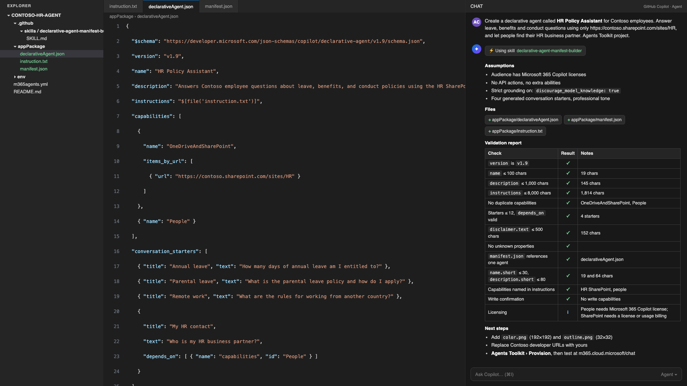

# 🤖 Declarative Agent Manifest Builder for GitHub Copilot

## Summary

This skill teaches GitHub Copilot to build Microsoft 365 Copilot declarative agents the way an experienced team would. The hard part of a declarative agent is rarely the idea. It's the package. Describe who the agent is for and what it should know, and Copilot writes the three files that matter: `declarativeAgent.json` on schema v1.9, the `manifest.json` that points at it, and an `instruction.txt` that will still behave after the next model refresh. It then runs 28 checks over the result and reports which ones failed. Hand it an existing manifest and it checks or upgrades that instead.

## Skill 💡

The full skill definition is in [`SKILL.md`](./SKILL.md). To use it, copy the `SKILL.md` file into your repository's `.github/skills/declarative-agent-manifest-builder/` folder.

### Trigger Phrases

Say any of these to GitHub Copilot to activate the skill:

- *"Create a declarative agent for..."*
- *"Build a Copilot agent manifest"*
- *"Generate declarativeAgent.json"*
- *"Add SharePoint knowledge to my agent"*
- *"Validate my declarative agent manifest"*
- *"Upgrade my agent to schema 1.9"*

## Description ℹ️

### The problem it addresses

Declarative agents that fail validation usually fail for boring reasons. A property copied from an older schema version. A capability block pasted in twice. A Teams channel URL with the tenant ID still in it, sitting in a public repo. An HR agent that worked for the developer, who had a Microsoft 365 Copilot license, and did nothing for the pilot group, who were on Copilot Chat. Instructions that behaved on Monday and drifted after a model update because they were one long paragraph.

None of that is difficult. It's a lot to hold in your head while you're trying to think about the actual scenario, which is why it belongs in a skill rather than a checklist nobody opens.

### What it does

1. **Maps the scenario to capabilities.** One capability object per need (`OneDriveAndSharePoint`, `GraphConnectors`, `TeamsMessages`, `Email`, `EmailActions`, `Meetings`, `MeetingActions`, `People`, `Dataverse`, `Fabric`, `WebSearch`, `EmbeddedKnowledge`, `CodeInterpreter`, `GraphicArt`, `ScenarioModels`), scoped as narrowly as you described it, and checked against the licensing tier your users actually have.
2. **Writes instruction.txt.** Markdown with OBJECTIVE, KNOWLEDGE AND TOOLS, RESPONSE RULES, a Goal/Action/Transition WORKFLOW, OUTPUT FORMAT and FINAL CHECK sections. Each capability is named where it's used, because the orchestrator can't guess.
3. **Writes declarativeAgent.json.** Schema v1.9 with conversation starters, `depends_on` links, `behavior_overrides` and an optional disclaimer. Localization, worker agents and sensitivity labels are there when you need them and out of the way when you don't.
4. **Writes manifest.json.** App manifest v1.30 with the `copilotAgents.declarativeAgents` reference, in either the Agents Toolkit layout or a standalone package.
5. **Validates and reports.** 28 checks: character counts, array maximums, URL rules, dependency references, unknown properties, licensing tier and confirm-before-write steps, shown as a pass/fail table.
6. **Tells you what's next.** Provisioning with Agents Toolkit, uploading the custom app, collecting SharePoint IDs, Responsible AI validation, keeping tenant identifiers out of public repos, and what to test first.

### The opinions baked in

These defaults come from shipping agents into environments where someone from risk or compliance reads the manifest before users ever see it. I'd rather start strict and loosen on request than explain afterwards why the agent sent an email on its own. All of them can be changed in `SKILL.md`.

- **Narrow scope by default.** A specific SharePoint site, not the tenant. Named connectors, not all of them. Tenant-wide knowledge gives noisier answers and a longer governance conversation, and very few scenarios need it on day one.
- **Strict grounding whenever there's a knowledge source.** `discourage_model_knowledge` goes on. An HR or finance agent that fills gaps from model knowledge is the agent that gets pulled.
- **Nothing writes without asking.** If `EmailActions` or `MeetingActions` is configured, the instructions get a step that shows the user what's about to happen and waits for a yes. In regulated settings this isn't optional, so the skill treats it as a rule everywhere.
- **Advisory domains get a disclaimer.** HR, legal, financial, medical. It costs you 500 characters and saves a review cycle.
- **It never invents tenant values.** Site URLs, connector IDs, Dataverse skill IDs and API endpoints that weren't supplied come back as placeholders, with a list of what to fill in. A plausible-looking fake GUID is worse than an obvious gap.

## Contributors 👨‍💻

[Arindam Choudhury](https://github.com/ari20089)

## Version history

Version|Date|Comments
-------|----|--------
1.0|October 23, 2026|Initial release

## Instructions 📝

1. Copy the [`SKILL.md`](./SKILL.md) file into your repository at `.github/skills/declarative-agent-manifest-builder/SKILL.md`
2. Open the repository in VS Code. An empty folder works, and so does an existing Microsoft 365 Agents Toolkit project
3. Open GitHub Copilot Chat
4. Say: *"Create a declarative agent that answers HR policy questions from our SharePoint HR site and can look up people"*
5. Copilot asks for anything it still needs, at minimum the agent's purpose and its knowledge sources, then writes the files and shows the validation report
6. Add your `color.png` (192x192) and `outline.png` (32x32, transparent) icons, provision with Microsoft 365 Agents Toolkit, and test the agent at m365.cloud.microsoft/chat

### Customization 🚀

- **Validate instead of build**: paste an existing `declarativeAgent.json` and say *"Validate my declarative agent manifest"* to get a check-by-check report without the file being rewritten. Useful on manifests inherited from another team before opening them in Agents Toolkit.
- **Standalone package**: add *"standalone app package"* to your request to get a literal GUID and inlined instructions instead of Agents Toolkit placeholders
- **Match your licensing**: say whether your users have a Microsoft 365 Copilot license, usage-based billing, or Copilot Chat with no billing. The skill keeps the capabilities to what that tier supports, which is the most common reason a pilot agent works for the developer and nobody else.
- **Make it yours**: drop your organization's developer URLs, standard disclaimer wording, or a house instruction template into the Rules or Step 2 sections of `SKILL.md`

## Prerequisites

* [GitHub Copilot](https://copilot.github.com/)
* [Visual Studio Code](https://code.visualstudio.com/)
* To provision and test the generated agent: [Microsoft 365 Agents Toolkit](https://aka.ms/M365AgentsToolkit) and a Microsoft 365 tenant that allows custom app upload. Grounding on SharePoint, connectors, embedded files or Dataverse needs usage-based billing or a Microsoft 365 Copilot license; Email, People, Teams messages and Meetings need the license.

## Known limitations

- The schema moves. v1.9 and app manifest v1.30 are current at the time of writing. When Microsoft publishes a newer version, update the version strings and the table in Step 5 of `SKILL.md`; the structure won't need to change.
- The Agents Toolkit project template still scaffolds `declarativeAgent.json` on schema v1.8 at the time of writing. The skill writes v1.9, and the "upgrade my agent to schema 1.9" trigger moves an existing v1.8 file across.
- It doesn't write API plugin manifests or OpenAPI documents. Bring those and it references them. Generating an API surface from a one-line description is how you end up with endpoints that don't exist.
- It can't look inside your tenant, so SharePoint IDs, connector IDs and Dataverse skill IDs come back as placeholders with a link to where to find them.
- The checks run inside GitHub Copilot Chat and are only as good as the rules in the file. Treat them as a pre-flight, not a sign-off. The platform's own validation is the authority, so run `wiqd agent validate` or provision through Agents Toolkit and read its output before you tell anyone it's done.

## Help

We do not support samples, but this community is always willing to help, and we want to improve these samples. We use GitHub to track issues, which makes it easy for community members to volunteer their time and help resolve issues.

You can try looking at [issues related to this sample](https://github.com/pnp/copilot-prompts/issues?q=label%3A%22sample%3A%20declarative-agent-manifest-builder%22) to see if anybody else is having the same issues.

If you encounter any issues using this sample, [create a new issue](https://github.com/pnp/copilot-prompts/issues/new).

Finally, if you have an idea for improvement, [make a suggestion](https://github.com/pnp/copilot-prompts/issues/new).

## Disclaimer

**THIS CODE IS PROVIDED *AS IS* WITHOUT WARRANTY OF ANY KIND, EITHER EXPRESS OR IMPLIED, INCLUDING ANY IMPLIED WARRANTIES OF FITNESS FOR A PARTICULAR PURPOSE, MERCHANTABILITY, OR NON-INFRINGEMENT.**

---

