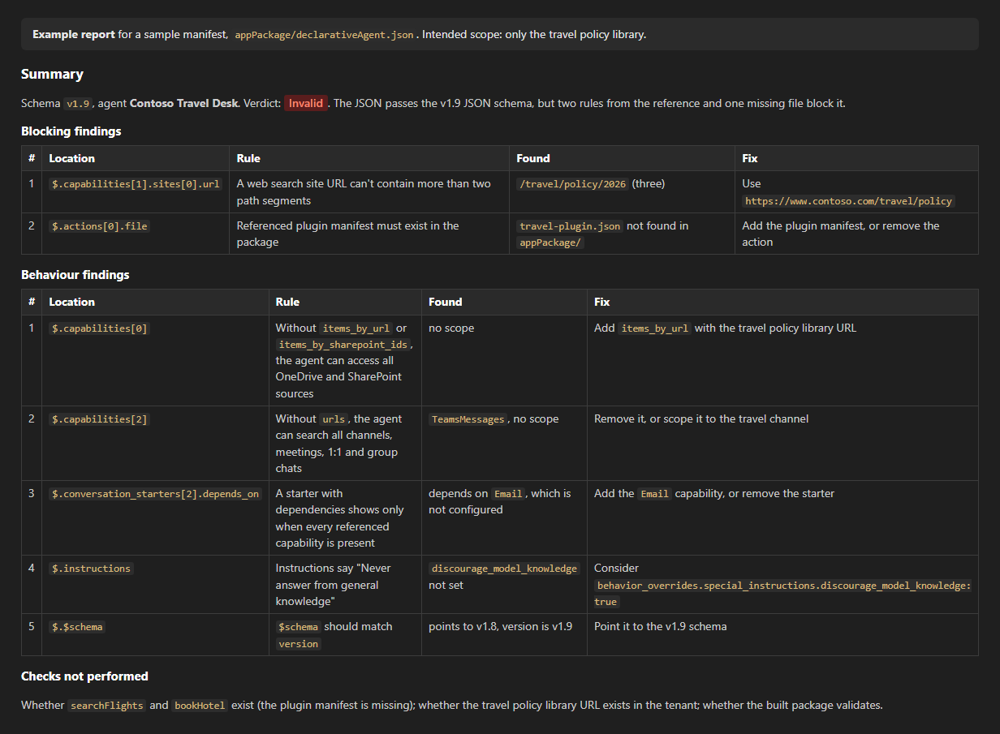

# Declarative Agent Manifest Review Skill

## Summary

This skill teaches GitHub Copilot to review a Microsoft 365 Copilot declarative agent manifest against the reference for its own schema version, and to report two kinds of finding separately: mistakes that make the document invalid, and valid configuration that does something the maker did not intend.

The first kind stops provisioning. The schema says that one unrecognized property anywhere makes the entire document invalid, so a typo such as `conversation_starter` is enough. The second kind ships without a warning: a `OneDriveAndSharePoint` capability with no `items_by_url` can access every OneDrive and SharePoint source in the organization, and a conversation starter that depends on a missing capability is never shown.

## Skill 💡

The full skill definition is in [`SKILL.md`](./SKILL.md). To use it, copy the `SKILL.md` file into your repository's `.github/skills/declarative-agent-manifest-review/` folder.

### Trigger Phrases

- "Review my declarative agent manifest"
- "Why does my agent fail to provision?"
- "Check declarativeAgent.json before I publish"
- "What content can this agent actually read?"

## Description ℹ️

The skill walks Copilot through five steps:

- **Identifying the schema version**, from the `version` property, and opening the reference page and JSON schema for that exact version
- **Checking the document against the schema**: unrecognized properties, required strings and their character limits, one capability of each type, starter, action and skill counts, and the limits on web search sites, Teams URLs, meetings and mailboxes
- **Checking references to files**: plugin manifests, embedded knowledge files (size and type), skill folders and localization keys
- **Checking what the configuration grants**: unscoped knowledge capabilities compared with the scope the maker intended, starters that cannot work, instructions that name functions or sources the manifest does not configure, grounding, licensing categories and preview features
- **Writing the report**, with the exact value found and the exact fix for each finding, and a list of what could not be checked without the tenant or the built package

### The design choice that matters

A valid manifest that reads the whole tenant is not broken, and a review that says it is loses the maker's trust. The skill keeps blocking findings and behaviour findings in separate tables, applies only the rules of the manifest's own version, and never reports as checked anything that needs the tenant or the built package.

## Prerequisites

* [GitHub Copilot](https://copilot.github.com/)
* [Visual Studio Code](https://code.visualstudio.com/)
* A [declarative agent](https://learn.microsoft.com/microsoft-365/copilot/extensibility/overview-declarative-agent) project, for example one created with the Microsoft 365 Agents Toolkit

## Contributors 👨‍💻

[Elliot Margot](https://github.com/OwnOptic)

## Version history

Version|Date|Comments
-------|----|--------
1.0|November 23, 2026|Initial release, checked against declarative agent schema 1.9

## Instructions 📝

1. Copy [`SKILL.md`](./SKILL.md) into your repository at `.github/skills/declarative-agent-manifest-review/SKILL.md`
2. Open the folder that contains your agent's `appPackage`
3. Open GitHub Copilot Chat
4. Ask: "Review my declarative agent manifest"
5. Give the path to the manifest and one sentence on which content the agent should be able to read
6. Fix the blocking findings first, then decide on each behaviour finding

## Help

We do not support samples, but this community is always willing to help, and we want to improve these samples. We use GitHub to track issues, which makes it easy for community members to volunteer their time and help resolve issues.

You can try looking at [issues related to this sample](https://github.com/pnp/copilot-prompts/issues?q=label%3A%22sample%3A%20declarative-agent-manifest-review%22) to see if anybody else is having the same issues.

If you encounter any issues using this sample, [create a new issue](https://github.com/pnp/copilot-prompts/issues/new).

Finally, if you have an idea for improvement, [make a suggestion](https://github.com/pnp/copilot-prompts/issues/new).

## Disclaimer

**THIS CODE IS PROVIDED *AS IS* WITHOUT WARRANTY OF ANY KIND, EITHER EXPRESS OR IMPLIED, INCLUDING ANY IMPLIED WARRANTIES OF FITNESS FOR A PARTICULAR PURPOSE, MERCHANTABILITY, OR NON-INFRINGEMENT.**

---

