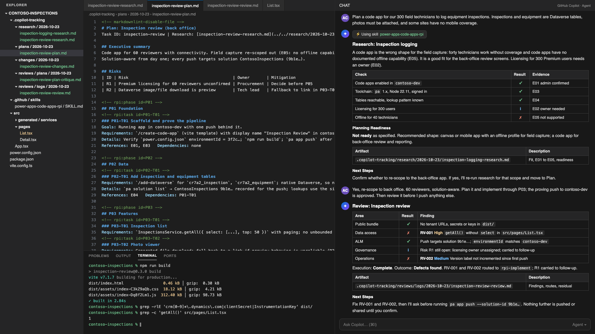

# ⚡ Power Apps Code Apps RPI for GitHub Copilot

## Summary

This skill teaches GitHub Copilot to take a Power Apps code app through the Hyper Velocity Engineering (HVE) Research, Plan, Implement, Review loop. Microsoft's code-apps plugin takes care of the build: scaffold, data sources, deployment. hve-core brings the RPI phases. Both do their part well. A few questions still need answering before either one starts. Are code apps turned on in that environment? Who's paying for the Premium licenses? Do the technicians need it to work offline? What's in a bundle that's going to sit on a public endpoint? This skill asks those first and writes the evidence down. Then it plans inside what the platform can actually do, lets the official plugin build, and reviews the result before anyone runs `pa app push`.

## Skill 💡

The full skill definition is in [`SKILL.md`](./SKILL.md). To use it, copy the `SKILL.md` file into your repository's `.github/skills/power-apps-code-apps-rpi/` folder.

### Trigger Phrases

Say any of these to GitHub Copilot to activate the skill:

- *"Plan a code app for..."*
- *"Is a code app right for this?"*
- *"RPI for my code app"*
- *"Review my code app before publishing"*
- *"Code app readiness"*

## Description ℹ️

### The problem it addresses

Code apps got good tooling quickly. During 2026 the npm `pa` CLI became the recommended CLI (with the `pac code` commands marked for deprecation in a future release), Microsoft shipped a GitHub Copilot plugin that scaffolds and deploys in a handful of commands, and Dataverse actions, flows and connection references arrived alongside. A developer can go from an empty folder to a published app in an afternoon.

Those questions sit outside the tooling's remit. Ask for an app for field technicians who work with no mobile coverage and it scaffolds one, even though the platform has no documented offline capability. A connector the environment's data loss prevention (DLP) policy blocks goes in without a word, and the app fails the first time someone opens it. A bundle with a tenant URL in it gets pushed to an endpoint anyone can fetch. Each of those is about ten minutes of checking before the first commit. After a pilot has started it's a lot more than that.

The skill puts HVE's phases around the official tooling:

1. **Research** answers fit and prerequisites, with an evidence ID against each finding. Is a code app the right shape, or should this be canvas, model-driven, Power Pages or a Power Apps component framework control? Are code apps enabled in the environment, is the real audience licensed, is the toolchain current? Can every table, connector, flow and action actually be reached, and what will DLP, sharing limits, Conditional Access and the public asset endpoint do once the app is live? If the shape is wrong, it says so and stops.
2. **Plan** writes an hve-core plan with phases and tasks. Every task names the exact plugin skill or `pa` command. Every unresolved decision and unsupported feature gets a risk row, and the acceptance criteria are ones the review can test. The critique goes through hve-core if it's installed; if not, the skill runs the self-critique in Step 2.
3. **Implement** delegates to `/create-code-app`, `/add-dataverse`, `/add-connector` and friends, or to the `pa` CLI. It records every step in a changes record and never pushes or shares without confirmation in that turn.
4. **Review** checks what the build tooling never looks at. Secrets or personal data in a bundle that's served publicly. `getAll` without `select`. Updates that resend fields that didn't change. A personal connection on a connector-backed source where the plan said connection references. A connector outside the DLP group. Whether anyone actually decided about the header and the version label. Each finding gets a severity and the phase it goes back to.

Every artifact lands under `.copilot-tracking/` in hve-core's folder layout, file naming and markers, whether or not hve-core is installed, so a team that adopts hve-core later finds its tracking files already in place.

### How it fits with the rest of the toolchain

| Need | Tool |
|---|---|
| Decide, plan and review a code app the HVE way | This skill |
| Scaffold, add data sources, deploy | [code-apps plugin](https://github.com/microsoft/power-platform-skills/tree/main/plugins/code-apps) in microsoft/power-platform-skills |
| The RPI phase skills, plan critique and review for code in general | [hve-core](https://github.com/microsoft/hve-core) |

### The opinions baked in

These defaults come from code apps that reached a pilot before anyone had checked who held a Premium license, and from connectors that passed the developer's environment and failed the DLP policy in the next one. I'd rather hear no from Research in the first hour than from Review in the last. All of them can be changed in `SKILL.md`, and the Customization section below lists the usual changes.

- **Research is allowed to say no.** If the evidence says the shape is wrong, the skill stops there and recommends the alternative. The example in `SKILL.md` does exactly that, then re-scopes to the part of the problem a code app does fit.
- **Licensing gets an owner before the first push.** Premium licenses for the whole audience are recorded as a decision with a name against it, in the research artifact, before anyone writes a line of code.
- **Solution-aware once the app leaves a developer's environment.** Personal connection IDs are fine while one developer is prototyping. The moment the app is headed for Test or Prod, connector-backed sources go through connection references and every push names the solution.
- **Compiled assets are served from a public endpoint with no IP restriction.** Any secret, token or personal data in source is a Critical finding, however internal the app feels.
- **Confirmation before every environment change.** `pa app push` and `pa app share` wait for a yes in the same turn, every time, and the skill says which environment and solution it is about to touch.

## Contributors 👨‍💻

[Arindam Choudhury](https://github.com/ari20089)

## Version history

Version|Date|Comments
-------|----|--------
1.0|October 23, 2026|Initial release

## Instructions 📝

1. Copy the [`SKILL.md`](./SKILL.md) file into your repository at `.github/skills/power-apps-code-apps-rpi/SKILL.md`
2. Install the Power Apps CLI and client library: `npm install --global @microsoft/power-apps-cli @microsoft/power-apps`, then `pa auth login`
3. Optional but recommended: install the official plugin with `/plugin marketplace add microsoft/power-platform-skills` and `/plugin install code-apps-preview@power-platform-skills` (the install commands are documented for the GitHub Copilot CLI), and install [hve-core](https://github.com/microsoft/hve-core) if you want its `/rpi-*` commands and its independent plan critique
4. Open GitHub Copilot Chat in the repository that will hold the app
5. Say: *"Plan a code app for our field technicians to log equipment inspections against Dataverse, with photos"*
6. Copilot asks for anything it still needs, at minimum who the app is for and which data it touches, then runs Research and reports the verdict with the artifact path
7. Continue with *"plan"*, *"implement"* and *"review"*, or say *"full"* to run the loop end to end with confirmation at every environment change

### Customization 🚀

- **Add your own checks**: more rows in the Review table in Step 4, for example a required telemetry wrapper or the house design system.
- **Start from an existing solution**: skip P01's proving push and point P02 at the solution you already have.
- **Make the critique a hard stop** so Plan can't complete without a recorded critique result.
- **Point P01 at your own fork** of the template repository instead of `microsoft/PowerAppsCodeApps`.

## Prerequisites

- [GitHub Copilot](https://copilot.github.com/) in [Visual Studio Code](https://code.visualstudio.com/) or the GitHub Copilot CLI
- Node.js 22 or later (required by the `pa` CLI and the official plugin), Git, and the Power Apps CLI
- A Power Platform environment with code apps enabled, and maker permissions in it
- For the Implement phase, the official code-apps plugin or the `pa` CLI. hve-core is optional (see Instructions, step 3)

## Known limitations

- The platform and the `pa` CLI are described as of October 2026. Code apps are generally available, but the official plugin is in preview and commands will change. The skill tells Copilot to read `pa --help` and the current reference when a command fails, and to say what changed.
- It's not a substitute for the official plugin or for hve-core. If the plugin isn't there, Copilot falls back to the documented `pa` commands. If hve-core isn't there, the artifacts still use hve-core's layout and the plan gets a self-critique rather than `/rpi-plan-critique`.
- Research can only check what the CLI and the repository expose. Admin-side facts such as DLP group membership and Conditional Access policies come back as open questions with an owner unless the user confirms them.
- The review reads code against a fixed list of checks. It never runs the app, so keep your linting and accessibility tooling in the pipeline, and it's no substitute for a penetration test.

## Help

We do not support samples, but this community is always willing to help, and we want to improve these samples. We use GitHub to track issues, which makes it easy for community members to volunteer their time and help resolve issues.

You can try looking at [issues related to this sample](https://github.com/pnp/copilot-prompts/issues?q=label%3A%22sample%3A%20power-apps-code-apps-rpi%22) to see if anybody else is having the same issues.

If you encounter any issues using this sample, [create a new issue](https://github.com/pnp/copilot-prompts/issues/new).

Finally, if you have an idea for improvement, [make a suggestion](https://github.com/pnp/copilot-prompts/issues/new).

## Disclaimer

**THIS CODE IS PROVIDED *AS IS* WITHOUT WARRANTY OF ANY KIND, EITHER EXPRESS OR IMPLIED, INCLUDING ANY IMPLIED WARRANTIES OF FITNESS FOR A PARTICULAR PURPOSE, MERCHANTABILITY, OR NON-INFRINGEMENT.**

---

