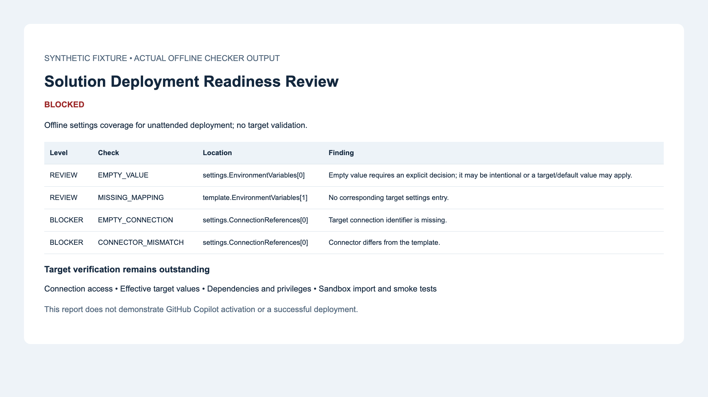

# Solution Deployment Readiness Review



*Actual checker output rendered as a report; not a GitHub Copilot activation screenshot.*

## Summary

Review Power Platform deployment settings before importing a solution. Compare a PAC-generated template with target settings, explain mapping defects, and distinguish static coverage from unverified target prerequisites.

## Skill

See [SKILL.md](SKILL.md). Copy the **whole folder** to `.github/skills/solution-deployment-readiness/`; scripts and references are required for the demonstrated workflow. Open the workspace in VS Code with GitHub Copilot enabled.

### Trigger phrases

- Review this solution's deployment readiness before import.
- Check these connection references and environment variables against the solution settings template.
- Identify missing target deployment settings and remaining target checks.

## Prerequisites

- GitHub Copilot and Visual Studio Code for skill activation.
- Python 3.9+ for the bundled offline checker (no third-party dependencies).
- A settings template generated from the exact solution artifact and proposed target settings.
- Power Platform CLI for generating a real template; optional target access for separately authorized verification.

## Instructions

1. Generate a template from your solution with `pac solution create-settings --solution-zip solution.zip --settings-file template.json`.
2. Supply that template, target settings, target label, and deployment mode to Copilot.
3. Ask it to use this skill and produce a review with evidence and remaining checks.
4. Resolve confirmed mapping defects and verify conditional target/default values.
5. Obtain target evidence and perform an authorized sandbox deployment before claiming deployment success.

### Try the offline demonstration

Run from this sample folder:

```sh
python3 scripts/review_settings.py --template examples/template.json --settings examples/incomplete-settings.json
python3 scripts/review_settings.py --template examples/template.json --settings examples/complete-settings.json
python3 -m unittest discover -s tests -v
```

The first command exits 1 for blockers. The second exits 0 for complete static coverage. Review-required reports also exit 0, so inspect the status. Invalid inputs exit 2. Add `--format json` for structured output. Reports go to stdout; redirect only to an appropriate local location.

Examples are synthetic settings, not real exports or importable solutions. [Incomplete report](examples/incomplete-report.md) and [complete report](examples/complete-report.md) show actual checker output.

## Scope and validation

The checker validates settings coverage and structure, not all solution components. The skill adds evidence-based review of supplied solution artifacts and target prerequisites. A clean report cannot prove connection access, dependency satisfaction, policy compliance, or successful import. See [VALIDATION.md](VALIDATION.md).

## Contributors

[Summit Bajracharya](https://github.com/summitbaj)

## Version history

| Version | Date | Comments |
|---|---|---|
| 0.1 | October 10, 2026 | Local draft with offline checker and synthetic fixtures |

## Help

We do not support samples, but this community is always willing to help, and we want to improve these samples. We use GitHub to track issues, which makes it easy for community members to volunteer their time and help resolve issues.

If you encounter any issues using this sample, [create a new issue](https://github.com/pnp/copilot-prompts/issues/new).

Finally, if you have an idea for improvement, [make a suggestion](https://github.com/pnp/copilot-prompts/issues/new).

## Disclaimer

**THIS CODE IS PROVIDED *AS IS* WITHOUT WARRANTY OF ANY KIND, EITHER EXPRESS OR IMPLIED, INCLUDING ANY IMPLIED WARRANTIES OF FITNESS FOR A PARTICULAR PURPOSE, MERCHANTABILITY, OR NON-INFRINGEMENT.**


